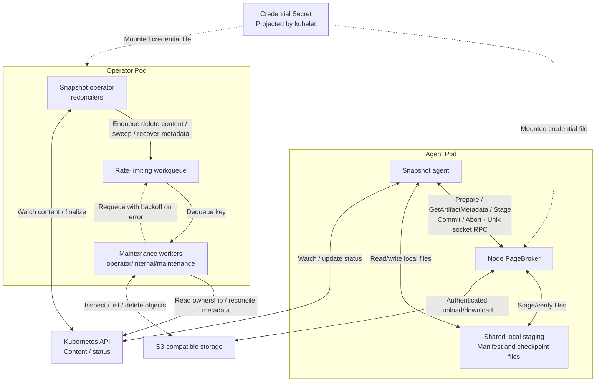
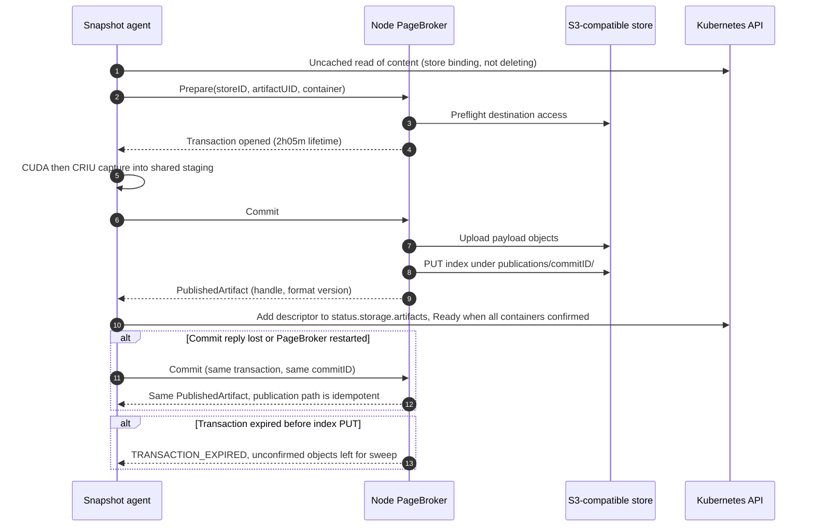
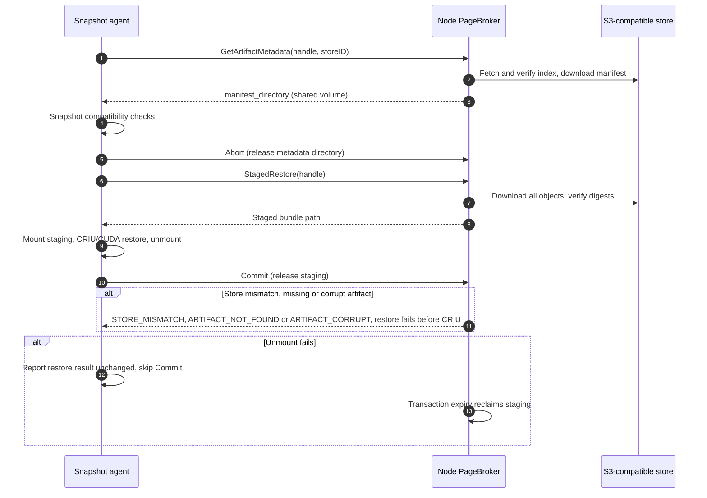
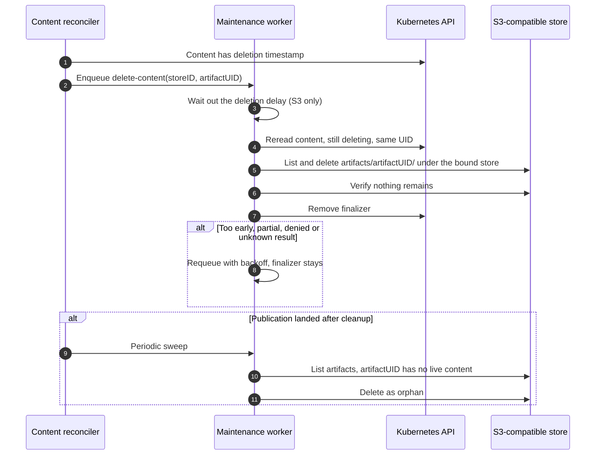

<!--
SPDX-FileCopyrightText: Copyright (c) 2026 NVIDIA CORPORATION & AFFILIATES. All rights reserved.
SPDX-License-Identifier: Apache-2.0
-->

# SNEP-237: S3-compatible object storage for checkpoints

<!-- toc -->
- [Summary](#summary)
- [Motivation](#motivation)
  - [Goals](#goals)
  - [Non-Goals](#non-goals)
- [Proposal](#proposal)
  - [Overview and flows](#overview-and-flows)
  - [Limitations, Risks, and Mitigations](#limitations-risks-and-mitigations)
- [Design Details](#design-details)
  - [API](#api)
    - [Kubernetes API and operator](#kubernetes-api-and-operator)
    - [Maintenance](#maintenance)
    - [Snapshot agent](#snapshot-agent)
    - [PageBroker: internal API](#pagebroker-internal-api)
  - [Security](#security)
  - [Configuration](#configuration)
  - [Storage and lifecycle](#storage-and-lifecycle)
    - [Publication and artifact format](#publication-and-artifact-format)
  - [Performance and Scalability](#performance-and-scalability)
  - [Monitoring](#monitoring)
  - [Dependencies](#dependencies)
  - [Test Plan](#test-plan)
  - [Graduation Criteria](#graduation-criteria)
- [Alternatives](#alternatives)
<!-- /toc -->

## Summary

Allow Snapshot to save checkpoint artifacts to S3-compatible object storage and
restore workloads from them.
PVC remains the default. Stage 1 uses one store per installation, selected at
Helm install/upgrade, and a fixed deletion delay for S3 artifacts. Stage 2
adds explicit coordination between active storage operations and maintenance.

## Motivation

S3 provides checkpoint storage without a shared checkpoint PVC. It is the first
additional backend; stable artifact references and separate backend adapters let
future stores be added with minimal changes to workload APIs.

### Goals

- Add S3 checkpoint/restore through PageBroker and cleanup through maintenance.
- Use the same in-process maintenance workqueue model for PVC, S3 and future backends.
- Preserve artifact identity and verify publication, restore and deletion across
  retries, restarts and storage configuration changes.
- Reject new operations after deletion begins. Stage 1 drains admitted operations
  through bounded transaction lifetimes; Stage 2 adds active-operation fencing.
- Keep storage credentials outside workload APIs and the agent process. The
  operator manager is the one exception: since maintenance runs in-process, it
  carries storage credentials, scoped to maintenance operations only.

### Non-Goals

- Storage classes, simultaneous stores, automatic fallback or artifact migration.
- Direct (unstaged) restore from S3, new feature-discovery APIs or
  workload-identity implementation.
- Moving CRIU/process orchestration into PageBroker or redesigning CUDA execution.
- Cross-component operation leases and generation fencing in Stage 1; those are
  deferred to Stage 2 after the conservative deletion contract is qualified.

## Proposal

PageBroker already handles checkpoint/restore through local staging; this design
adds its S3 backend. Content is bound to its store before capture and becomes
Ready only after confirmed publication. Restore validates compatibility and stages
the complete bundle before CRIU/CUDA execution.

The operator runs maintenance in-process: a bounded worker pool handles content
deletion, periodic sweeps and metadata recovery through per-backend adapters.
Workers access PVC or S3 directly and never through PageBroker.

### Overview and flows



The sequence diagrams below show each flow's happy path and its main failure
branch. Details follow in [Design Details](#design-details).







**Checkpoint:** agent → prepare/validate destination → CUDA then CRIU/filesystem
capture into staging → PageBroker derives `commitID` and commits the matching
publication → agent persists the descriptor and Ready. `commitID` is a fixed name
for one publication, computed from the store ID, the content UID and the container
name. Every component can compute it before the upload, so a retry writes to the
same place and recovery knows exactly what to fetch; see
[Publication and artifact format](#publication-and-artifact-format).

**Restore:** agent → GetArtifactMetadata → Snapshot compatibility gates → StagedRestore
downloads/verifies the full bundle → CRIU/CUDA restore → unmount → Commit cleanup.
Once fully staged, restore needs no further S3 reads. The later executor
compatibility gate still runs before process restore.

**Cleanup:** once a `PodSnapshotContent` has a deletion timestamp, no new operation
may start on it: no checkpoint writing into it and no restore reading from it.
Creating a new `PodSnapshot` is unaffected; it gets its own content. The reconciler
enqueues `delete-content`, and a periodic tick enqueues `sweep`. For S3 the worker
first waits out a deletion delay, then rereads ownership, deletes the artifact
under the bound store and removes the finalizer. Anything short of confirmed
deletion keeps the finalizer and retries. The delay and its reasons are defined
once under [Maintenance](#maintenance).

**Recovery:** the checkpoint was published but the agent died before writing the
descriptor into status. The reconciler sees a bound content with a missing
descriptor and enqueues `recover-metadata`. A worker computes the publication's
`commitID`, fetches exactly that index, and writes the descriptor back. It never
lists the folder and picks the newest object; a conflicting publication fails
closed.

### Limitations, Risks, and Mitigations

| Risk | What goes wrong | How the design handles it |
| --- | --- | --- |
| Changed store | The installation is switched to another store, or back again. Content bound to the old store cannot be reached through the new one. If the old store is gone, its content can never be cleaned up. | The content keeps `storeID`, `artifactHandle` and format version; the bucket layout is keyed by content UID. Switching S3 → PVC → the same S3 configuration hashes to the same `storeID`, so old checkpoints restore again with no migration. Every operation refuses a mismatched binding before any I/O. While the original store is inactive, deletion cannot be confirmed: the content gets a `StoreInactive` condition and an event and keeps its finalizer; the sweep retries. An administrator can set the annotation `snapshot.nvidia.com/release-artifacts=true` to drop the finalizer; the artifacts left behind are recorded in an event. |
| Credentials or S3 outage | The key is revoked or the store is unreachable during a checkpoint, a restore or a cleanup. | Check destination access before capture and source access before restore. Bound retries and timeouts. Preflight cannot guarantee later access, so every operation handles denial mid-way. Access denial never proves that an artifact is missing, so it never triggers deletion or recovery. |
| Uncertain publication | PageBroker uploaded the checkpoint but the `Commit` reply to the agent was lost, or one side restarted. Nobody knows whether the publication exists. | The publication has a fixed name, `commitID`, that both sides compute in advance. A retried `Commit` writes to the same path and is a no-op if it is already there. Recovery fetches exactly that name and never picks by timestamp. Uploads resume only from complete staging; CUDA/CRIU are never replayed. |
| Cleanup races | On S3, deleting an artifact while a restore is still downloading it fails the restore, and an upload that lands after cleanup leaves an orphan. On PVC neither happens: an unlinked file stays readable to a process that has it open. | S3 deletion waits out a fixed delay before touching storage; PVC deletion is unchanged. The delay is defined under [Maintenance](#maintenance). Its consequence: S3 artifact reclamation lags a content deletion by a little over two hours in Stage 1. A publication that still lands after cleanup is an orphan the next sweep removes. Stage 2 replaces the delay with explicit active-operation tracking. |
| Metadata loss | The `PodSnapshotContent` objects are lost, for example a cluster rebuilt from scratch. The artifacts are still in the bucket but nothing owns them, and the next sweep would delete them as orphans. | Back up the content objects separately. While they are being restored from backup, pause sweeps and new operations until an administrator resumes. |
| Operator process risk | Maintenance already runs inside the operator process for PVC, so a panic or leak there affects reconciliation, and a leadership change drops in-flight work. S3 widens this: the process now holds store credentials and performs network transfers, not only local deletes. | Existing mitigations stay: panics isolated per task, bounded worker pool and transfer concurrency, pending work rebuilt from cluster state after any restart or leadership change. Credentials are scoped to maintenance operations only. |

## Design Details

### API

#### Kubernetes API and operator

Extend the existing `PodSnapshotContent`; proposed fields below are additions only:

```yaml
spec:
  storage:                               # Store binding fixed before capture
    storeID: store-v1-<digest>            # Prevent access through another configured store
status:
  storage:                               # Results confirmed by checkpoint Commit
    artifacts:                           # One descriptor per captured container
      - containerName: main              # Associate the publication with its container
        artifactHandle: <opaque-handle>   # Locate the publication inside its bound store
        artifactFormatVersion: snapshot.pagebroker/v1  # Layout of the publication in the store, not the checkpoint format
```

```go
// CheckpointStorageBinding is spec.storage; immutable with the rest of spec.
type CheckpointStorageBinding struct {
    // +kubebuilder:validation:Pattern=`^store-v1-[0-9a-f]{64}$`
    StoreID string `json:"storeID"`
}

// CheckpointStorageStatus is status.storage; one descriptor per confirmed container.
type CheckpointStorageStatus struct {
    // +listType=map
    // +listMapKey=containerName
    Artifacts []PublishedContainerArtifact `json:"artifacts"`
}

type PublishedContainerArtifact struct {
    ContainerName         string `json:"containerName"`
    ArtifactHandle        string `json:"artifactHandle"`
    ArtifactFormatVersion string `json:"artifactFormatVersion"`
}
```

Both `spec.storage` and `status.storage` are optional pointers so legacy content
without a binding stays valid. `artifactHandle` is where PageBroker put the
publication inside the store: a directory on PVC, the index object key on S3. The
agent stores it and hands it back for restore and metadata reads, so restore never
reconstructs the path from naming conventions and the layout can change per format
version without an API change. `artifactFormatVersion` versions how PageBroker laid
the bundle out in the store (a directory on PVC, an index plus data objects on S3);
PageBroker selects its reader by backend and this value. CRIU and CUDA formats are
unchanged and are validated by the existing compatibility checks.

The operator sets `spec.storage.storeID` when it creates the `PodSnapshotContent`.
The whole spec is immutable, so the binding can never be added or changed
afterwards. A `PodSnapshotContent` represents one capture attempt, so its immutable
UID already distinguishes a new attempt from a retry of the same attempt. Each
container's publication is named by a `commitID` derived from `storeID`,
`artifactUID` and `containerName`; it needs no Kubernetes API field. The
definition, rationale and a worked example are under
[Publication and artifact format](#publication-and-artifact-format).

A store is the single storage configuration of the installation, defined in Helm
and rendered into the storage ConfigMap described under
[Configuration](#configuration). It is not a Kubernetes resource in Stage 1.

Compute `storeID` as `store-v1-` + SHA-256 of a versioned, fixed-field canonical
storage identity. For S3, encode backend, resolved endpoint, region, bucket and
normalized prefix. Normalize the endpoint to lowercase scheme
and DNS host, omit the scheme's default port, retain a non-default port and remove
only a root trailing slash. Reject user information, query strings, fragments and
non-root endpoint paths. Resolve an empty/default endpoint to an explicit provider
endpoint before hashing. Normalize the prefix by removing leading/trailing slashes.
For PVC, encode backend, namespace, claim and normalized base path. Access settings
are excluded: addressing mode, TLS CA, checksum mode and credentials describe how a
client talks to the bucket, not where the bucket is. Changing them never changes
the binding or the artifact location, so existing checkpoints stay reachable.

`storeID` is the identity of the physical location, not only a guard against
configuration changes. It keys the artifact prefix in the bucket, it is an input to
`commitID`, and it scopes maintenance so a worker can never delete under a different
store. A reference to a configuration object cannot replace it: the object can be
edited to point elsewhere, and the digest is what detects that. When a storage CRD
introduces multiple stores, content gains a `storeRef` beside `storeID`; the
reference says where to resolve, the digest says what was resolved.

These fields are raw identity inputs. The S3 store prefix used in artifact keys
additionally appends installation/store identifiers derived from Helm; those values
are not fed back into the SHA-256. Operator, PageBroker and maintenance share one
Go/C++ fixture set covering default and non-default ports, rejected paths, regions,
addressing modes and prefixes, and must produce identical digests and effective
artifact prefixes.

`PodSnapshot` and `SnapshotJob` retain their current workload request APIs. Later
storage-class selection can bind the same content fields without changing restore
references. Legacy content without a binding is accepted only in PVC mode.

#### Maintenance

The operator owns scheduling and retention. `operator/internal/maintenance/` is the
existing implementation of this design for PVC; S3 adds a backend and the changes
listed below.

**Roles.** The content reconciler decides *when*: a deletion timestamp enqueues
`delete-content`, a periodic tick enqueues `sweep`, and a confirmed publication with
no descriptor in status enqueues `recover-metadata`. A bounded pool of workers
decides *whether*: it waits out the deletion delay where one applies, rereads
ownership, takes the artifact lock and then acts. Backends know *how*: they list, inspect and delete
objects under the store prefix for PVC or S3. Maintenance never calls PageBroker.

**Eligibility.** Per-content deletion is scoped by the content's bound `storeID` and
its artifact UID, which together name `artifacts/<artifactUID>/` in exactly one
store; every container and unfinished attempt under it is covered. A sweep lists
artifact UIDs under the store prefix and keeps only those with no live content.
`recover-metadata` derives the expected `commitID` and accepts only a confirmed index
carrying it.

**Deletion delay (S3 only).** On PVC an unlinked file stays readable to a process
that already has it open, so deletion is immediate today and stays that way. On S3
a deleted object disappears under a running download, and an upload accepted
before transaction expiry can land after cleanup. So for content bound to an S3
store the worker waits before touching storage until the deletion timestamp plus:
the longest gap between the agent's deletion check and `Prepare` (a fixed margin),
the 2h05m PageBroker transaction lifetime, and a clock-skew allowance that also
absorbs provider-side completion of a request accepted just before expiry. The
agent checks the deletion timestamp once, as today; nothing is reread. The
consequence is that S3 reclamation lags deletion by a little over two hours in
Stage 1. Stage 2 replaces the delay with active-operation tracking.

**Safety.** Any result that is too early, partial, denied or unknown keeps the finalizer and
requeues with backoff. Nothing is ever selected by object timestamp; a conflicting
or duplicate publication fails closed and needs explicit repair. A publication that
lands after cleanup is an orphan the next sweep removes. On operator start or new
leadership, pending work is rebuilt from cluster state rather than trusted to have
survived in memory.

**Changes to the current implementation.** `recover-metadata` as a third mode; the
store ID on the work-item key; a shared lock on `(storeID, artifactUID)` held across
ownership recheck, storage operation and status or finalizer update; no drain on
leadership loss, where today `Queue.Start` drains on every shutdown; and failed
sweeps requeue with backoff, where today they wait for the next scan interval.

**Implementation notes.** Queue, dedup, retry and worker mechanics are those of
the existing `operator/internal/maintenance/` package and are not restated here.
What S3 adds to the operator process is store credentials and an S3 SDK client;
backend calls stay idempotent because a request issued before cancellation may
still finish.

Maintenance and PageBroker share the store-ID, artifact format and Stage 1
transaction and deletion-delay contracts, with Go/C++ compatibility fixtures. Stage 2 adds
the cross-component active-operation and generation-fencing contract.

#### Snapshot agent

What changes for S3, and why:

- **Deletion check unchanged.** The agent checks the content's deletion timestamp
  once, as today, and then starts its PageBroker transaction. The gap between that
  check and `Prepare` is bounded by code and is one input to the S3 deletion delay
  under [Maintenance](#maintenance); there is no reread.
- **Metadata through PageBroker.** The agent has no credentials and no bucket
  access, so it obtains the manifest through `GetArtifactMetadata` on the shared
  volume and then runs the existing compatibility checks unchanged. Storage checks
  stay mandatory even when compatibility is bypassed.
- **Publication descriptors in status.** The handle returned by `Commit` is the
  only way to find the publication later, so the agent persists it per container
  and sets Ready only when every required container is confirmed.
- **Staged restore only.** Direct restore mounts a local checkpoint directory,
  which S3 does not have. The agent derives the mode from the bound store's
  backend: PVC keeps the configured mode, S3 always stages.
- **Cleanup separate from success.** Unmount before `Commit`; if unmount fails,
  report the restore result unchanged, skip `Commit` and let transaction expiry
  reclaim staging. Never rerun a restore to retry cleanup.

Snapshot retains Kubernetes authorization, CRIU, canonical manifest creation and
process orchestration.

#### PageBroker: internal API

Extend [pagebroker.proto](../../../agent/pagebroker/v1/pagebroker.proto), using the
existing local Unix socket. These are proposed additions; wire numbers must be
reconciled with the separate CUDA integration. Only new fields are shown.

```protobuf
// Identity before an artifact has been published.
message ArtifactIdentity {
  string artifact_uid = 1;      // Stable artifact UID for the owning PodSnapshotContent.
  string container_name = 2;    // Captured container within that content.
}

// Binds a logical artifact to its store before a publication handle is known.
message ArtifactTarget {
  string store_id = 1;           // Require the configured destination store.
  ArtifactIdentity artifact = 2; // Logical checkpoint destination.
}

// Confirmed publication, persisted by Snapshot for later operations.
message PublishedArtifact {
  string store_id = 1;                 // Require the original configured store.
  string artifact_handle = 2;          // Opaque locator within that store.
  string artifact_format_version = 3;  // Backend reader version, not CRIU version.
}

message PrepareStagedCheckpointRequest {
  ArtifactTarget target = 3; // Logical destination instead of a caller's path.
}

message StagedRestoreRequest {
  PublishedArtifact artifact = 3; // Exact committed source to download and verify.
}

message CommitComplete {
  PublishedArtifact published_artifact = 1; // Checkpoint result; absent for restore Commit.
}

message GetArtifactMetadataRequest {
  PublishedArtifact artifact = 1; // Exact committed publication whose metadata is needed.
}

// Success result; errors use the existing Failure message.
message GetArtifactMetadataComplete {
  string manifest_directory = 1; // Shared local directory with verified manifest.yaml.
}
```

PageBroker resolves the backend from configuration. Reject conflicting artifact
and legacy filesystem selectors; retain existing wire numbers and legacy PVC reads.

**One new operation**, `GetArtifactMetadata`, extends `Request.command` /
`Response.result`. Its logical signature is:

```text
GetArtifactMetadata(
  request_id: string,       // Existing envelope: correlate the reply.
  transaction_id: string,   // Existing envelope: own the temporary metadata directory.
  artifact: PublishedArtifact
) -> GetArtifactMetadataComplete | Failure
```

PageBroker verifies the store binding, committed publication, supported format,
metadata access and integrity, then returns a temporary local directory containing
`manifest.yaml` for the exact requested publication. A mismatch returns `Failure`;
PageBroker never substitutes another publication. Snapshot decides how to use this
metadata; restore compatibility checks are one caller flow. Full payload verification
belongs to `StagedRestore`.

The directory remains valid until the transaction is closed with `Abort` or expires.
The caller releases it after reading, on every exit path. Cleanup removes temporary
metadata, never the publication. Checkpoint publication recovery belongs to the
maintenance `recover-metadata` work item.

Artifact deletion and orphan listing belong to maintenance backends, not the
PageBroker RPC. PageBroker still releases its own transaction resources through
`Abort` and restore `Commit`; these never delete retained checkpoints.

Extend `Failure.code` with `STORE_MISMATCH`, `ACCESS_DENIED`, `STORAGE_UNAVAILABLE`,
`ARTIFACT_NOT_FOUND`, `ARTIFACT_CORRUPT`, `UNSUPPORTED_ARTIFACT`,
`TRANSACTION_EXPIRED` and `OUTCOME_UNKNOWN`. `TRANSACTION_EXPIRED` changes the
current contract, which returns `TRANSACTION_NOT_FOUND` for expired transactions;
PageBroker returns it for an expired transaction it still remembers, keeps
`TRANSACTION_NOT_FOUND` for unknown IDs, and the agent client adds it to its
terminal-failure set. The agent treats any failure code it does not recognize as
terminal, so during a rolling upgrade an old agent meeting the new code and a new
agent meeting the old code both stop the same way; no version gate is needed. An
access error never proves absence.
Use existing conditions with storage-specific reasons. Keep errors bounded and
credential-free.

Reuse request/transaction IDs and the 64 KiB message limit. A transaction's maximum
lifetime starts at successful Prepare and retries never extend it. PageBroker checks
expiry before every new storage operation and immediately before publishing the
checkpoint index; expiry returns `TRANSACTION_EXPIRED` and leaves unconfirmed data
for sweeping. Every SDK request uses a deadline no later than the transaction expiry,
so no new request starts after it. Expiry bounds request issue, not provider
completion: a request the provider accepted before expiry may finish after it. The
S3 deletion delay under [Maintenance](#maintenance) accounts for that. Bound individual
transfers through broker timeouts and SDK retries. Extend `Abort` to stop transfers
before cleanup; it cannot undo committed data or CUDA/CRIU. Restore `Commit` cleans
local staging.

### Security

Helm values contain Secret references only. PageBroker and maintenance may share
one credential Secret or use separate ones; the required permissions differ:

| Component | S3 actions on the configured bucket and prefix |
| --- | --- |
| Node PageBroker | `GetObject`, `PutObject`, `HeadObject`, `ListBucket` (prefix-scoped), `AbortMultipartUpload` |
| Operator maintenance | `ListBucket` (prefix-scoped), `GetObject` (index reads), `HeadObject`, `DeleteObject` |

These permissions come from the provider's policy attached to the credentials.
Kubernetes service-account RBAC governs only Kubernetes API access and grants no
storage rights. Kubelet projects each component's credential Secret to a fixed path, `/etc/snapshot/s3-credentials/credentials`, in both node
PageBroker and the operator manager container, using the provider SDK's native
credentials-file format (e.g. the AWS shared-credentials-file syntax). This
path and format are part of the wire contract, not implementation-defined per
component. The agent receives no credential file; workload requests and RPCs
carry references.

The operator manager is an S3-credentialed component, not just a Kubernetes-API
client: a process compromise exposes storage credentials, and a maintenance-path
bug (an unbounded retry loop or a memory leak in a storage SDK) can affect the
reconcile loop that owns every other content object. Mitigate with panic recovery
per work item, resource limits sized for the combined workload, and keeping the
storage SDKs on the same audited dependency set PageBroker uses.

An external manager or administrator rotates the Secret. Use a projection that
supports updates, without a fixed `subPath`. Both PageBroker and the operator
manager use refreshable credential providers. If an SDK cannot reload the projected
file, the component observes the projection directory and atomically replaces its
storage client after parsing a valid update. New operations use the replacement;
in-flight operations retain the old client only for their bounded lifetime. An
invalid update fails new operations closed and surfaces a credential condition.
Neither component requires Kubernetes Secret-read permission or a Pod restart.

Use verified TLS and an optional custom CA. Scope storage permissions to the
configured store, restrict local sockets/staging, and exclude secrets from logs
and status. Maintenance checks artifact UID, store binding and fresh ownership
before deletion; protect against arbitrary paths and symlinks. Grant the
operator's service account only the storage permissions needed for cleanup and
metadata repair, without GPU or host-process access.

Enable provider-side encryption at rest on the bucket; Snapshot does not check
or enforce it.

### Configuration

PVC remains the default. `storage.type` already selects the maintenance backend;
the `s3` block below replaces the reserved `s3.uri` placeholder in the chart.

**Supported stores.** `s3` means the S3 API, not one vendor. The backend works
against AWS S3 or any S3-compatible store, selected by `endpoint`; an empty
endpoint means AWS. A store must provide Signature V4 authentication with a static
access key and secret, `ListObjectsV2`, multipart upload, and read-after-write
consistency for `PUT` followed by `GET` and `LIST`. Stage 2 fencing additionally
needs conditional `PUT` with `If-None-Match`. Stores that do not speak the S3 API,
and provider-native identity models, are separate backends behind the same
adapter interface.

```yaml
storage:
  type: s3                       # AWS S3 or any S3-compatible store, selected by endpoint
  s3:
    bucket: checkpoint-bucket
    prefix: snapshots
    region: us-east-1
    endpoint: ""                 # Empty = AWS; HTTPS endpoint of any S3-compatible store
    addressingMode: ""           # path | virtual-host; default virtual-host when endpoint is empty, else path
    auth:
      mode: secret              # Stage 1; workloadIdentity may be added later
      credentialsSecretRef:      # Shared by PageBroker and maintenance unless overridden
        name: snapshot-s3-credentials
        key: credentials
      pageBroker:
        credentialsSecretRef: {} # Optional override for node PageBroker
      maintenance:
        credentialsSecretRef: {} # Optional override for operator maintenance
    tls:
      caBundleConfigMapRef: ""   # Optional custom CA
```

The chart renders the non-secret part into the storage ConfigMap, which the
operator and PageBroker decode into the shared `api/storage` configuration:

```go
type Config struct {
    Type string `json:"type"` // pvc | s3
    PVC  *PVC   `json:"pvc,omitempty"`
    S3   *S3    `json:"s3,omitempty"`
}

// S3 is the S3 API configuration. Endpoint selects the store; empty means AWS.
type S3 struct {
    Bucket         string `json:"bucket"`
    Prefix         string `json:"prefix"`
    Region         string `json:"region"`
    Endpoint       string `json:"endpoint"`
    AddressingMode string `json:"addressingMode"` // path | virtual-host; see default below
}
```

`addressingMode` is a client setting, not part of `storeID`. When omitted it
defaults to `virtual-host` if `endpoint` is empty and `path` otherwise; the chart
schema and both components apply the same rule. Credentials are not part of this
struct; they come from the projected Secret files.

- Render non-secret settings into the existing configuration ConfigMap, mounted
  into both node PageBroker and the operator manager.
- In S3 mode, omit checkpoint PVC mounts on the agent; preserve node staging. In
  PVC mode, the operator manager mounts the shared claim directly.
- Configure the maintenance worker pool size, per-task timeout and retry backoff on
  the operator manager itself.
- For S3, configure the admission margin and clock-skew allowance that feed the
  deletion delay defined under [Maintenance](#maintenance); Helm rejects zero or
  unbounded values. The 2h05m PageBroker transaction lifetime is a constant and is
  not configurable. PVC has no deletion delay.
- Match Snapshot/PageBroker image versions. PageBroker reads mounted configuration
  and has no Kubernetes client.

### Storage and lifecycle

#### Publication and artifact format

Store the existing per-container bundle under
`<store-prefix>/artifacts/<artifactUID>/containers/<name>/`; the store prefix includes
the configured prefix and installation/store identifiers. Upload immutable payloads,
then publish the index last. The index binds store/artifact/container and format
version, and lists file/directory paths, permissions, sizes and file SHA-256 digests.
Reject unsafe paths, unsupported formats, missing files and checksum mismatches.

Each index also carries the deterministic `commitID` derived from `storeID`,
`artifactUID` and container name. Since a new capture attempt receives a new
`artifactUID`, retries and restarts of one attempt derive the same value while a new
attempt cannot adopt its publication. `Commit` publishes under
`publications/<commitID>/` and is idempotent for that exact path.
`recover-metadata` derives the expected value and accepts only a confirmed index
with the same identity fields and `commitID`. It never selects by object write time.
Multiple matching indexes or a confirmed different ID is a conflict that requires
explicit repair.

Why a deterministic `commitID`: a `Commit` reply can be lost, and the agent or
PageBroker can restart mid-publication. Without a fixed ID a retry would publish a
second copy, and recovery would have to guess which object is right by timestamp.
With one, a retry publishes to the same path and is a no-op, and recovery computes
the expected ID and looks for exactly that. The three inputs are what name one
publication: one capture attempt (`artifactUID`), one container of it, in one store.
Every component already holds those values, so no new API field is needed, and
including the store means a publication is valid only under the store that
produced it.

Canonical encoding, shared by Go and C++: write each field as a 4-byte big-endian
length followed by its UTF-8 bytes, in the order `snapshot.commit/v1`, `storeID`,
`artifactUID`, `containerName`; `commitID` is `commit-v1-` followed by the lowercase
hex SHA-256 of those bytes. `storeID` uses the same framing with its own version
tag. The shared Go/C++ vectors live in `api/storage/testdata/identity.json`.

Worked example. Content `psc-7f3a` is created bound to store `store-v1-9c1e…`; its
UID is the artifact UID and the pod has one container, `main`. Agent, PageBroker
and maintenance can all compute `commit-v1-4b8d…` before capture starts.

1. The agent sends `prepare_staged_checkpoint` with the target. PageBroker derives
   the same value and reserves
   `artifacts/<uid>/containers/main/publications/commit-v1-4b8d…/`.
2. Capture finishes and the agent sends `commit`. PageBroker uploads the data
   objects under that path, then writes `index.json` last; the index carries the
   `commitID` inside it.
3. The reply is lost. The agent cannot tell whether step 2 finished.
4. The agent sends `commit` again on the same transaction. PageBroker checks
   `publications/commit-v1-4b8d…/index.json`. Absent: finish the upload to that
   path. Present and matching: return the same `PublishedArtifact` without writing.
   Present with a different `commitID` or failed verification: conflict, fail
   closed and leave it for repair. There is never a second publication.

Recovery uses the same value. Suppose the agent crashed after PageBroker
published and before status was written, so `psc-7f3a` has a bound store and no
descriptor for `main`. The reconciler enqueues `recover-metadata`. The worker
computes `commit-v1-4b8d…` from the content's `storeID`, UID and the container
name and fetches exactly `publications/commit-v1-4b8d…/index.json`; it never
lists the folder and picks the newest. Index present with a matching embedded
`commitID`: write the descriptor into status. Index absent: nothing was
published. A different `commitID` confirmed under that container: conflict, fail
closed.

A retried capture is a new content object with a new UID, so its hash and path
differ and it can neither adopt nor overwrite the old publication. The
`commitID` is not the transaction ID: the transaction ID is random, per RPC
session and expires; the `commitID` is deterministic, per publication and
permanent.

Example publication descriptors; digest values are placeholders:

```protobuf
// PVC
store_id: "store-v1-<pvc-digest>"
artifact_handle: "artifacts/<artifactUID>/containers/main"
artifact_format_version: "snapshot.pagebroker/v1"
```

```protobuf
// S3
store_id: "store-v1-<s3-digest>"
artifact_handle: "artifacts/<artifactUID>/containers/main/publications/<commitID>/index.json"
artifact_format_version: "snapshot.pagebroker/v1"
```

Reader selection uses **backend + version**. PVC keeps its directory representation;
S3 reconstructs the same logical bundle from index-listed objects at
`<publication>/data/<relative-file-path>`. CRIU/CUDA retain their producer formats.

### Performance and Scalability

Bound transfers separately from CUDA admission. Size memory-backed staging against
both containers' limits; reject insufficient capacity before capture. Cap the
maintenance worker pool size and sweep batch size explicitly — worker concurrency
adds directly to the operator process's own resource footprint. Measure throughput,
peak memory and latency before setting defaults.

### Monitoring

Use existing conditions with storage-specific reasons and rate-limited updates.
Measure phase duration, transfer bytes/retries, credential failures, staging
pressure and cleanup backlog. Expose workqueue depth, per-key retry counts and
worker utilization as operator metrics. Count transaction expiry, credential reload
success/failure and cleanup deferrals; expose remaining S3 deletion-delay time.
Correlate logs with content, transaction and work-item key. Report cleanup separately
and preserve historical success.

### Dependencies

- Always-running PageBroker, shared local staging and its separate image.
- Separate CUDA CustomStorage integration and existing Snapshot compatibility checks.
- S3-compatible service plus C++ PageBroker and Go maintenance SDKs/adapters.
- Shared store-ID, artifact-format and publication/read/delete contracts.

Before coding, finalize the credentials-file format and SDKs, canonical store-ID
encoding, protobuf tags, the S3 deletion-delay inputs, recovery-mode control and
numeric resource/time limits. Finalize the active-operation and generation-fencing
protocol before enabling Stage 2 concurrent deletion.

### Test Plan

Tracking and test issues are not yet assigned. Cover unit/configuration checks,
backend integration with a disposable S3-compatible service, and GPU end-to-end tests.

- **API/configuration:** immutable store bindings, unique container descriptors,
  identical Go/C++ `commitID` derivation, exact recovery matching, identical Go/C++
  store-ID results for endpoint/region/prefix variants, flipping `addressingMode`
  leaves `storeID` unchanged and old content restorable, and legacy PVC.
- **Restore mode:** S3 restore with `restoreMode: direct` configured still takes
  the staged path; PVC restore keeps the configured mode.
- **Helm/security:** S3 installation without checkpoint PVC; credentials only in
  PageBroker/operator manager; matching images and an operator service account
  without GPU/host mounts. Rotate and revoke credentials while already-running Go
  and C++ clients prove that subsequent operations use the replacement without a
  Pod restart.
- **PVC-first maintenance:** per-content deletion and scheduled sweeps through the
  in-process worker pool; legacy layout, artifact UID checks, symlink refusal and
  finalizer completion.
- **Workqueue lifecycle:** duplicate enqueues coalescing to one key, operator
  restart/leadership change rebuilding pending work, retry backoff and exhaustion
  (cap then surface a condition), graceful `ShutDownWithDrain` under SIGTERM,
  immediate cancellation on leadership loss, and every maintenance mode using the
  same `(storeID, artifactUID)` lock, including candidates resolved by a sweep.
- **Storage/RPC:** disposable S3-compatible service; upload/index publication,
  format/path/digest rejection, fixed transaction expiry across retries, rejection
  immediately before a late index publication, bounded messages, maintenance
  pagination, Abort and inspection expiry.
- **Failure/recovery:** invalid credentials before capture, outage during transfer,
  lost replies/restarts, exact `commitID` repair, missing/duplicate/conflicting
  publications and no CUDA/CRIU replay.
- **Lifecycle/concurrency:** inspection cleanup on success/refusal/requeue/cancellation;
  uncached deletion checks; S3 deletion waiting the complete delay while PVC
  deletion stays immediate; expiration during upload/download; an index `PUT`
  accepted before expiry that completes after cleanup is removed by the following
  sweep; stale publishers, incomplete attempts and capture-node loss. Stage 2 adds concurrent
  delete/read/publish races, operation expiry and stale-generation rejection.
- **End to end:** cross-node capture/restore/delete; recovered workload state and
  inference; restore after S3 loss following staging; PVC↔S3-A↔S3-B mismatch
  refusal; store switch round trip S3-A → PVC → S3-A restores content captured
  before the switch; cleanup blocked by an inactive store reports the condition
  and keeps the finalizer, and the release annotation drops it.
- **Operations:** denied decryption/deletion, supported provider versioning/retention,
  metadata recovery pause/restart/resume and PVC cleanup parity.

Qualify the real CUDA path, multi-rank and partial-destination failures, and vLLM,
SGLang and TensorRT-LLM workloads. Run the same lifecycle on an external S3 endpoint;
an emulator or mocked CUDA path alone does not qualify provider/GPU support.

### Graduation Criteria

- **Alpha (Stage 1):** demonstrate S3 capture/restore without a checkpoint PVC and
  deletion after the S3 deletion delay with PVC deletion unchanged; prove the
  delay and transaction expiry, exact `commitID` recovery, PVC compatibility, credential
  rotation and core failure paths.
- **Beta (Stage 2):** qualify advertised providers and GPU workloads under sustained
  load; add explicit active-operation tracking and generation fencing, then prove
  concurrent cleanup/read/publication safety across component and leader restarts.
- **GA:** document support, upgrades/rollback and recovery; demonstrate artifact/API
  compatibility and supported versioning/retention behavior. Multi-store support is
  not required.

## Alternatives

- **Maintenance Jobs (`batch/v1`), one per task:** isolates storage credentials
  and failures from the operator manager, and reuses Kubernetes for scheduling,
  retries (`backoffLimit`) and completion tracking (Job `Complete`/TTL). Rejected
  as the primary design for Stage 1 because per-task Pod startup adds latency and
  scheduling load at sweep scale, and because it needs a second image/binary
  (`operator/maintenance/main.go`) and its own RBAC surface. A variant keeps the
  existing workqueue for scheduling and dispatches a Job per task; it keeps the
  Pod overhead and adds the dispatch protocol, so it is not chosen either. Revisit
  if holding S3 credentials and transfer failures inside the operator process
  proves too costly.
- **Maintenance sidecar:** isolates credentials from the manager container without
  per-task Pod startup, but needs its own dispatch protocol and still shares the
  operator Pod's lifecycle. Not chosen for Stage 1.
- **Stage 2 fencing authority:** Kubernetes operation leases let the operator and
  agents coordinate through the existing API but require PageBroker cancellation
  to be authoritative; storage-resident epochs let every PageBroker enforce a fence
  directly but require conditional-write and consistency guarantees from every
  supported provider. Stage 2 selects one protocol after Stage 1 concurrency and
  failure testing; Stage 1 does not claim either mechanism.
- **Storage CRD reference as the binding:** a future CRD for multiple stores could
  carry the binding as an object reference instead of a digest. Rejected for
  Stage 1 because a reference names a mutable object and cannot prove which
  location an artifact was written to; the digest can. The two compose later as
  `storeRef` plus `storeID`, so adopting the digest now does not conflict with
  that design.
- **Streaming restore or storage classes now:** useful later, but expand Stage 1
  lifetimes and selection semantics; retain full staging and one bound store.
