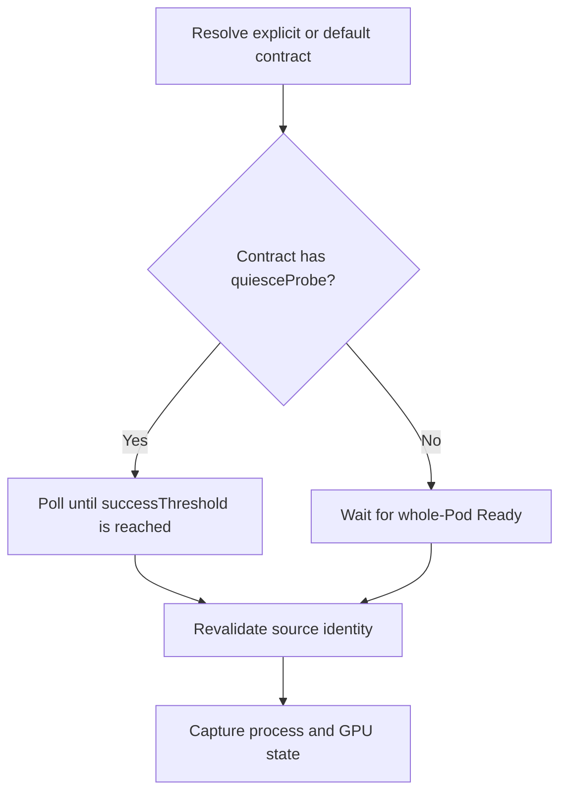
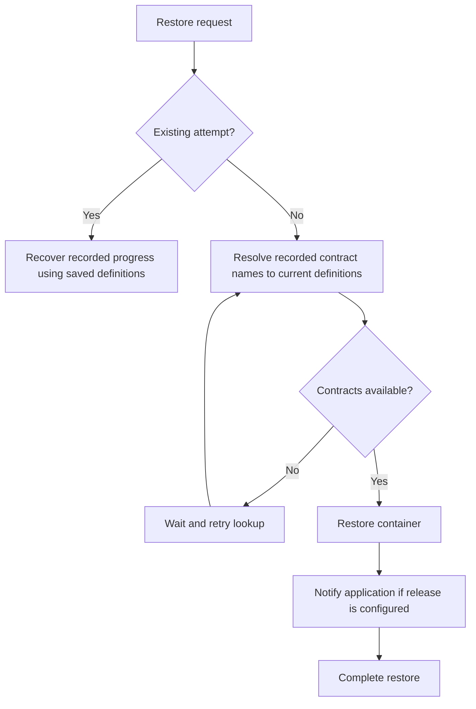
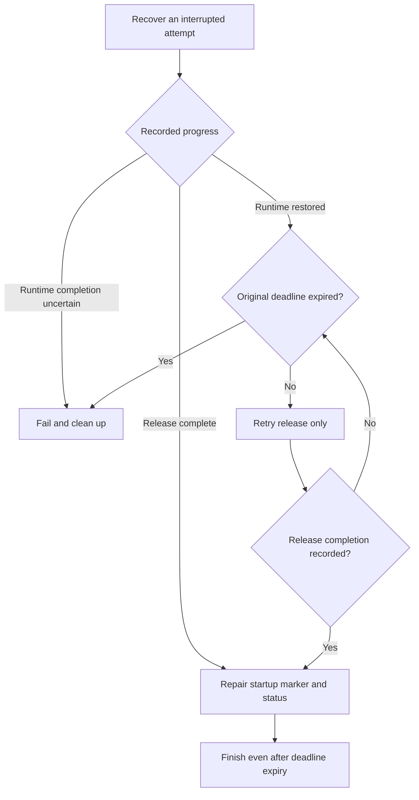

<!--
SPDX-FileCopyrightText: Copyright (c) 2026 NVIDIA CORPORATION & AFFILIATES. All rights reserved.
SPDX-License-Identifier: Apache-2.0
-->

# SNEP-411: Application contracts for checkpoint and restore

Tracking issue: [#411](https://github.com/ai-dynamo/snapshot/issues/411)

<!-- toc -->
- [Summary](#summary)
- [Motivation](#motivation)
  - [Goals](#goals)
  - [Non-Goals](#non-goals)
- [Proposal](#proposal)
  - [Defaults and user probes](#defaults-and-user-probes)
  - [Limitations, Risks, and Mitigations](#limitations-risks-and-mitigations)
    - [Backward compatibility and migration](#backward-compatibility-and-migration)
- [Design Details](#design-details)
  - [API](#api)
    - [Application contract binding](#application-contract-binding)
    - [SnapshotJob](#snapshotjob)
    - [ClusterApplicationContract](#clusterapplicationcontract)
    - [Checkpoint metadata](#checkpoint-metadata)
  - [Capture and restore execution](#capture-and-restore-execution)
    - [Recovery guarantees](#recovery-guarantees)
  - [Security](#security)
  - [Configuration](#configuration)
  - [Monitoring](#monitoring)
  - [Test Plan](#test-plan)
  - [Graduation Criteria](#graduation-criteria)
- [Appendix](#appendix)
  - [References](#references)
<!-- /toc -->

## Summary

Application contracts define how Snapshot checks capture readiness and notifies
an application after restore. Administrators install contracts; users select them
in PodSnapshot or SnapshotJob.

## Motivation

Before capture, the application must tell Snapshot it is safe to checkpoint.
After restore, Snapshot must tell the application it may recover connections
and other resources before serving requests.

Today, this exchange uses files on a shared control volume. HTTP and Unix
signals let applications expose other interfaces. Contracts let users select
an engine integration without repeating endpoints, signals, and timing settings.

### Goals

- Configure both PodSnapshot and SnapshotJob through the same contract API.
- Record per-container contract names for resolution at capture and restore.
- Provide the existing file integration as an installed, configurable default contract.

### Non-Goals

- Requesting application preparation, draining, or quiescence.
- Continuing the source application after capture.
- Defining application serving-readiness checks or engine recovery steps.
- Running arbitrary commands or general-purpose hook sequences.

## Proposal

A `ClusterApplicationContract` defines two optional actions: `quiesceProbe` checks
capture readiness; `restoreRelease` notifies the application after process and
GPU restoration. The application owns capture safety, recovery, and serving
readiness. Users select a contract by name for each captured container.

### Defaults and user probes

Containers without a binding use the administrator-configured default contract,
initially `snapshot-files`. A missing contract blocks the operation; it never
causes fallback to another contract.

An empty contract is valid. An omitted `quiesceProbe` waits for the whole Pod's
`Ready` condition, including sidecars and readiness gates. An omitted
`restoreRelease` sends no application notification.

Preserve all user-defined readiness, startup, and liveness probes on source and
destination containers. SnapshotJob stops injecting file readiness probes.
When restore startup gating is enabled, inject the `restore-complete` startup
probe only if the destination container has none. Custom startup probes must prevent premature
success, liveness must tolerate recovery, and readiness must wait for serving.

### Limitations, Risks, and Mitigations

Capture is limited to one container per PodSnapshot. An HTTP control endpoint
must work before release, including after restore at a new Pod IP.

| Risk | Required handling |
| --- | --- |
| Unsafe capture signal | The application stays safe until capture; integration tests verify recovery and inference. |
| Recreated contract name | Administrators validate compatibility or publish a new name. |
| Lost release response | Applications handle duplicate delivery; deadline expiry can terminate an already released application. |
| Custom probes during recovery | Workload owners configure probes to tolerate recovery. |
| Shared HTTP endpoint | The application coordinates releases for destinations restored at different times. |
| Unprotected HTTP listener | The deployment restricts endpoint access. |

#### Backward compatibility and migration

Artifacts without contract metadata retain legacy release behavior regardless of
the cluster default. Two capture changes may require workload updates:

- User probes are preserved. Workloads that relied on Snapshot replacing or
  removing them must adjust their probes.
- The default file contract checks `ready-for-snapshot` directly, independently
  of Pod readiness. Workloads that need Pod readiness instead must select a
  contract without `quiesceProbe`.

Upgrade participating agents before enabling contracts: older agents ignore the
new fields. Before downgrading, stop assigning captures and restores using contracts
to those agents, including restores from existing artifacts with contract bindings.

## Design Details

### API

All resources use `nvidia.com/v1alpha1`. Existing structs below show only the
added fields.

#### Application contract binding

PodSnapshot selects contracts through `spec.applicationContract.containers`, a
list keyed by source container name:

```go
type PodSnapshotSpec struct {
	ApplicationContract *ApplicationContractBinding `json:"applicationContract,omitempty"`
}

type ApplicationContractBinding struct {
	// +listType=map
	// +listMapKey=name
	Containers []ContainerApplicationContractBinding `json:"containers"`
}

type ContainerApplicationContractBinding struct {
	Name        string                       `json:"name"`
	ContractRef ApplicationContractReference `json:"contractRef"`
}

type ApplicationContractReference struct {
	Name string `json:"name"`
}
```

Each `name` must match a container in `spec.source.podRef.containers`.
`contractRef.name` must be a nonempty Kubernetes resource name. Bindings are
immutable with the PodSnapshot or SnapshotJob spec.

```yaml
apiVersion: nvidia.com/v1alpha1
kind: PodSnapshot
metadata:
  name: model-snapshot
spec:
  source:
    podRef:
      name: model-source
      containers: [main]
  applicationContract:
    containers:
      - name: main
        contractRef:
          name: cooperative-http-v1
```

#### SnapshotJob

Add `applicationContract` to `SnapshotJob.spec.podSnapshotTemplate`. The controller
copies it into the generated PodSnapshot. Each entry must name a target container.

```go
type PodSnapshotTemplate struct {
	ApplicationContract *ApplicationContractBinding `json:"applicationContract,omitempty"`
}
```

```yaml
spec:
  podSnapshotTemplate:
    targetContainers: [main]
    applicationContract:
      containers:
        - name: main
          contractRef:
            name: cooperative-http-v1
```

#### ClusterApplicationContract

ClusterApplicationContract is cluster-scoped with an immutable spec. Administrators
can publish a new name or delete and recreate an existing one. Name-only references
always select a ClusterApplicationContract, including in saved checkpoints.
References do not bind to UIDs; no `kind` field is introduced.

```go
type ClusterApplicationContractSpec struct {
	QuiesceProbe   *QuiesceProbe   `json:"quiesceProbe,omitempty"`
	RestoreRelease *RestoreRelease `json:"restoreRelease,omitempty"`
}

type QuiesceProbe struct {
	QuiesceProbeHandler `json:",inline"`

	InitialDelaySeconds int32 `json:"initialDelaySeconds,omitempty"`
	PeriodSeconds       int32 `json:"periodSeconds,omitempty"`
	TimeoutSeconds      int32 `json:"timeoutSeconds,omitempty"`
	SuccessThreshold    int32 `json:"successThreshold,omitempty"`
}

type QuiesceProbeHandler struct {
	File    *ControlFileAction   `json:"file,omitempty"`
	HTTPGet *LifecycleHTTPAction `json:"httpGet,omitempty"`
}

type RestoreRelease struct {
	RestoreReleaseHandler `json:",inline"`

	PeriodSeconds  int32 `json:"periodSeconds,omitempty"`
	TimeoutSeconds int32 `json:"timeoutSeconds,omitempty"`
}

type RestoreReleaseHandler struct {
	File     *ControlFileAction   `json:"file,omitempty"`
	HTTPPost *LifecycleHTTPAction `json:"httpPost,omitempty"`
	Signal   *SignalAction        `json:"signal,omitempty"`
}

type ControlFileAction struct {
	Name string `json:"name"`
}

type LifecycleHTTPAction struct {
	Path string `json:"path"`
	Port int32  `json:"port"`
}

type SignalAction struct {
	Signal string `json:"signal"`
}
```

When present, `quiesceProbe` requires exactly one of `file` or `httpGet`, and
`restoreRelease` requires exactly one of `file`, `httpPost`, or `signal`.

Defaults are `initialDelaySeconds: 0`, `periodSeconds: 1`,
`timeoutSeconds: 1`, and `successThreshold: 1`. The initial delay is nonnegative;
other values must be positive. Period and timeout defaults apply to both actions.
`timeoutSeconds` bounds one call, not the total operation.

There is no `failureThreshold`: a failed check resets the success count and keeps
waiting without restarting the container. Reset the count when the source container
restarts or is replaced; measure initial delay from that container's start time.

File names must be single path components within the container's
`SNAPSHOT_CONTROL_DIR`. Absolute paths, separators, `.` and `..` are invalid.
The probe and release cannot use the same name. Internal names such as
`cuda-checkpoint-job` are reserved; `ready-for-snapshot` and `restore-complete`
remain valid for their respective actions.

HTTP paths must begin with `/` and contain no authority, query, or fragment.
Ports range from 1 through 65535. Only HTTP is supported, and the agent derives
the host from the target Pod IP. Host overrides, custom headers, and request
bodies are not part of this API.
Signal names are restricted to `SIGUSR1` and `SIGUSR2`.

**Transport behavior**

| Action | Success condition |
| --- | --- |
| File probe | The marker exists as a regular file. |
| HTTP probe | GET returns `200`. |
| File release | The agent atomically publishes the marker in the destination control directory. |
| HTTP release | POST with an empty body returns `200` or `204`, acknowledging acceptance. Recovery may continue asynchronously. |
| Signal release | The agent sends the signal to the verified restored process-tree root, not the placeholder process. Delivery does not acknowledge handler completion. |

GET and POST response bodies are ignored; no attempt ID is sent. All unsuccessful
HTTP release requests, including connection failures, are retried until the
restore deadline. Signal handlers must be installed before capture. Shared HTTP
endpoints receive no container identifier and must coordinate the required releases.

Example HTTP contract (illustrative endpoints):

```yaml
apiVersion: nvidia.com/v1alpha1
kind: ClusterApplicationContract
metadata:
  name: cooperative-http-v1
spec:
  quiesceProbe:
    httpGet:
      path: /snapshot/quiesced
      port: 9001
    timeoutSeconds: 2
  restoreRelease:
    httpPost:
      path: /snapshot/restored
      port: 9001
    timeoutSeconds: 2
```

File readiness can also be combined with signal release:

```yaml
spec:
  quiesceProbe:
    file:
      name: ready-for-snapshot
  restoreRelease:
    signal:
      signal: SIGUSR1
```

#### Checkpoint metadata

Add optional `applicationContract` to `PodSnapshotContentSpec` and checkpoint metadata.
Before capture, the operator fills missing bindings with the configured default
and saves all selected names in the immutable content spec. The agent includes
these bindings in the checkpoint; definitions and UIDs are not stored there.
Changing the default affects only captures whose bindings are not yet saved.

Restore maps source bindings to destination containers. Destination Pods do not
select contracts, and restore does not consult the cluster default.

### Capture and restore execution

**Capture**



The agent saves the resolved definition for capture retries and restarts. The
application must clear stale readiness markers before initialization and remain
safe once its capture signal succeeds.

**Restore and release**



New restore attempts use current definitions; active attempts keep saved definitions
across retries and restarts, even if the contract is deleted or recreated. Release
must be idempotent because delivery may repeat. Success acknowledges the
notification, not serving readiness; application recovery may continue asynchronously.

**Deadlines.** SnapshotJob's `activeDeadlineSeconds` bounds its source lifecycle.
A direct PodSnapshot waits for capture readiness, request deletion, or source
termination.

The restore timeout covers runtime restoration and release. Its absolute deadline
survives retries and restarts. If release completion is not recorded in time,
fail and clean up, even if the application received a notification whose response
was lost.

#### Recovery guarantees

Attempt progress survives agent restarts. Only one agent may execute or recover
a destination attempt, and recovery must verify the destination's identity.
Stale release markers must not release a restored process early.



Recovery never repeats CRIU restore in the same container. An omitted release
also records completion and publishes the startup marker.

Restores with contract bindings use agent-owned recovery records, not workload-written
markers. Legacy restores without a record keep marker-based recovery.

### Security

Kubernetes RBAC governs contract management. A binding on PodSnapshot can trigger
application actions without changing the Pod, so it does not establish the Pod
owner's consent. Authorization must cover both the request and the target Pod.

HTTP requests go directly to the Pod IP without redirects or environment proxies.
Reject host-network Pods for HTTP actions. Containers share the Pod network, so
HTTP permissions must account for the whole Pod. Deployments must restrict
access to the unencrypted control listener.

Confine file operations to the container's control directory; reject symlinks
and path traversal. Signals target the verified restored process; callers cannot supply
a host PID. Protect bindings and attempt records as agent-owned metadata.
Logs and Events must not include response bodies or application memory.

**Open question:** should HTTP authentication be supported initially, and how
should capture and restore obtain credentials? The API has no credential fields.

### Configuration

Snapshot installs this ClusterApplicationContract with the release:

```yaml
apiVersion: nvidia.com/v1alpha1
kind: ClusterApplicationContract
metadata:
  name: snapshot-files
spec:
  quiesceProbe:
    file:
      name: ready-for-snapshot
  restoreRelease:
    file:
      name: restore-complete
```

This Helm setting selects the cluster default for PodSnapshot and SnapshotJob:

```yaml
operator:
  defaultApplicationContract: snapshot-files
```

To change it, install another ClusterApplicationContract, set its name here, and apply
with `helm upgrade`. Empty values are invalid. Omit a container's binding to use
this default; an explicit `contractRef` takes precedence.

### Monitoring

Report waiting for quiescence and release failures in snapshot and restore
status. Add Events for missing contracts, invalid configuration, and release failures.
Log routine unsuccessful probe polls only at debug level.

### Test Plan

- **API:** validate optional actions, empty contracts, exclusive handlers, timing
  defaults, immutable specs, unique container names, and target membership.
  Check binding propagation from SnapshotJob through checkpoint metadata.
- **Capture:** test success thresholds, source restarts, cancellation, deadlines,
  and Pod readiness fallback. Verify user probe preservation, direct default-file
  checks, and startup gating only when enabled and no user startup probe exists.
- **Contracts:** test installation, default changes, explicit precedence, and
  persisted bindings. Missing contracts block new attempts; recreation unblocks
  them. Active attempts keep their definitions across deletion and agent restart.
  Old artifacts retain legacy release behavior regardless of the default.
- **Recovery:** inject failures around runtime restore, release, persistence,
  and startup-marker publication. Verify the original deadline, release retries,
  repair after recorded success, and no repeated CRIU restore. Cover concurrent
  agents, omitted release, and legacy marker recovery.
- **Transports:** test status codes, ignored bodies, retries, redirect/proxy and
  host-network rejection, file confinement, stale markers, and signal targets.
  Verify file/signal destination isolation and shared-HTTP coordination.
- **Integrations:** validate file, HTTP, and file-readiness/signal-release with
  inference after restore. Cover new Pod IPs, release before serving, asynchronous
  recovery, and custom probes. Advertise only validated combinations and document
  supported engine versions, topologies, and required application settings.

### Graduation Criteria

Alpha requires the API validation, legacy compatibility, and transport/recovery
tests, with documented supported application versions and topologies.
Beta requires operational evidence under repeated agent restarts and a security
review of the privileged execution paths. GA requires a stable application
contract, compatibility coverage for previously produced artifacts, and
documented failure and recovery procedures.

## Appendix

### References

- [Workload contract](../../reference/workload-contract.md)
- [Restore Pod contract](../../reference/restore-pod-contract.md)
- [Kubernetes probes](https://kubernetes.io/docs/concepts/workloads/pods/probes/)
- [Kubernetes lifecycle hooks](https://kubernetes.io/docs/concepts/containers/container-lifecycle-hooks/)
- [gVisor application-driven checkpoint/restore](https://gvisor.dev/docs/user_guide/checkpoint_restore/#application-driven-checkpointrestore)
