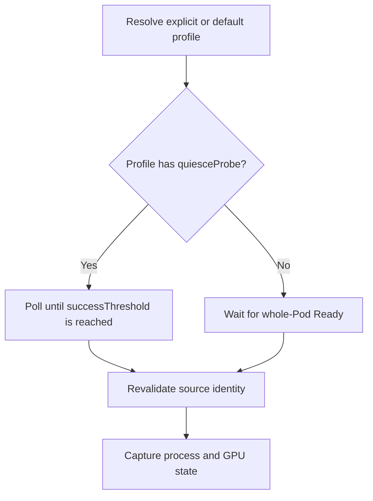
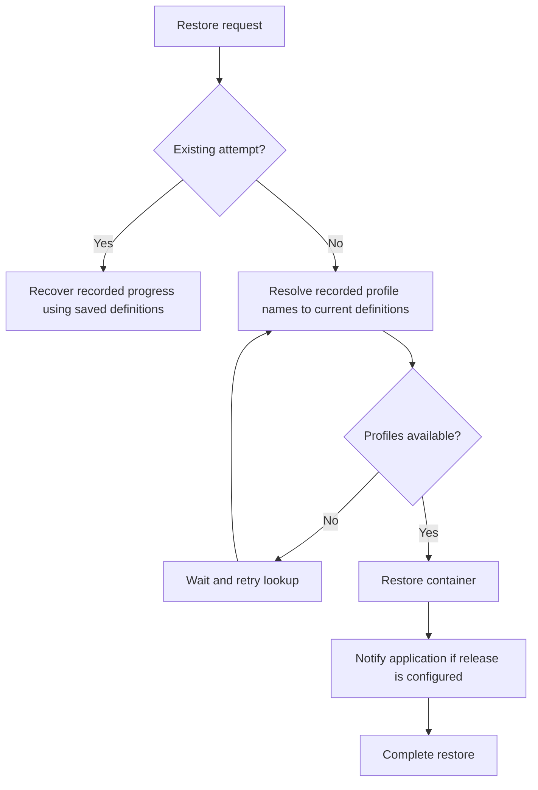
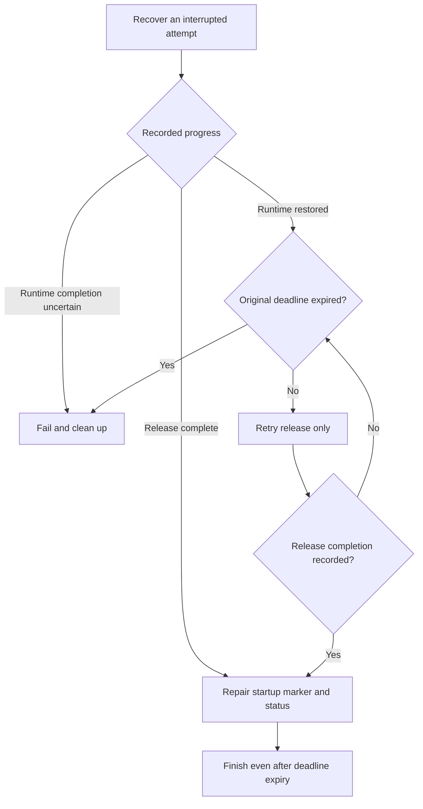

<!--
SPDX-FileCopyrightText: Copyright (c) 2026 NVIDIA CORPORATION & AFFILIATES. All rights reserved.
SPDX-License-Identifier: Apache-2.0
-->

# SNEP-411: Application profiles for checkpoint and restore

Tracking issue: [#411](https://github.com/ai-dynamo/snapshot/issues/411)

<!-- toc -->
- [Summary](#summary)
- [Motivation](#motivation)
  - [Goals](#goals)
  - [Non-Goals](#non-goals)
- [Proposal](#proposal)
  - [Defaults and user probes](#defaults-and-user-probes)
  - [Limitations, Risks, and Mitigations](#limitations-risks-and-mitigations)
    - [Backward compatibility and migration](#backward-compatibility-and-migration)
- [Design Details](#design-details)
  - [API](#api)
    - [Application contract](#application-contract)
    - [SnapshotJob](#snapshotjob)
    - [ApplicationProfile](#applicationprofile)
    - [Checkpoint metadata](#checkpoint-metadata)
  - [Capture and restore execution](#capture-and-restore-execution)
    - [Recovery guarantees](#recovery-guarantees)
  - [Security](#security)
  - [Configuration](#configuration)
  - [Monitoring](#monitoring)
  - [Test Plan](#test-plan)
  - [Graduation Criteria](#graduation-criteria)
- [Appendix](#appendix)
  - [Detailed test coverage](#detailed-test-coverage)
  - [References](#references)
<!-- /toc -->

## Summary

Application profiles define how Snapshot checks capture readiness and notifies
an application after restore. Administrators install profiles; users select them
in PodSnapshot or SnapshotJob.

## Motivation

Snapshot and the application need to communicate in both directions. Before
capture, the application tells Snapshot that it is safe to checkpoint. After
restore, Snapshot tells the application that process and GPU restoration is
complete and it may begin recovery. A restored process is not necessarily ready
to serve: the application may need to rebuild connections or other resources
before accepting requests.

Today, this communication uses files on a shared control volume. This proposal
adds HTTP and Unix-signal options while keeping application preparation and
recovery logic in the application. Reusable profiles let users select an engine
integration without repeating its endpoints, signals, and timing settings.

### Goals

- Configure both PodSnapshot and SnapshotJob through the same profile API.
- Record per-container profile names for resolution at capture and restore.
- Provide the existing file integration as an installed, configurable default profile.

### Non-Goals

- Requesting application preparation, draining, or quiescence.
- Continuing the source application after capture.
- Defining application serving-readiness checks or engine recovery steps.
- Running arbitrary commands or general-purpose hook sequences.

## Proposal

Administrators install an `ApplicationProfile` with optional `quiesceProbe` and
`restoreRelease` actions. Users select a profile by name for each captured
container. Snapshot checks readiness before capture and sends any configured
release notification after restoring process and GPU state.

The application is responsible for capture safety, recovery, and serving
readiness. Integration documentation lists supported engine versions and
required application configuration.

### Defaults and user probes

Snapshot installs `snapshot-files`, an ApplicationProfile using the existing
`ready-for-snapshot` and `restore-complete` files. Containers without an explicit
binding use the administrator-configured default profile, initially
`snapshot-files`. Explicit bindings take precedence. A missing profile, including
the configured default, blocks the operation rather than silently falling back.

An empty profile is valid. In any selected profile, an omitted `quiesceProbe`
uses the source Pod's `Ready` condition; an omitted `restoreRelease` sends no
application notification.

Preserve every user-defined readiness, startup, and liveness probe on source
and destination containers. SnapshotJob no longer needs to inject file readiness:
the installed profile checks the file directly. When restore startup gating is
enabled, inject the `restore-complete` startup probe only if the destination
container has no user-defined startup probe.

On restored containers, custom startup probes must prevent premature startup
success, liveness must tolerate recovery, and readiness must stay false until
serving is available. Snapshot tracks restoration independently of these probes.

### Limitations, Risks, and Mitigations

Capture remains limited to one container per PodSnapshot. Profiles configure
interfaces an application already implements; they cannot make a serving
endpoint usable while the application is waiting for release. An HTTP control
endpoint must work after runtime restore, before release, including at a new
Pod IP. Only unencrypted HTTP is supported; HTTPS is out of scope.

Integration tests must validate capture and restore with the deployment's
probes and networking. Snapshot trusts the application's capture signal.

| Risk | Effect | Mitigation or owner responsibility |
| --- | --- | --- |
| Premature capture signal | The checkpoint contains unsafe application state. | The application maintains capture safety; integration tests verify recovery and inference. |
| Recreated profile name | New restores use a potentially incompatible definition. | Administrators validate compatibility or publish a new name. |
| Lost release response | Delivery repeats; deadline expiry may terminate an already released application. | Applications handle duplicates; Snapshot enforces the retry deadline. |
| Custom probes during recovery | Kubernetes restarts a recovering container. | Workload owners configure probes to tolerate recovery. |
| Shared HTTP endpoint | Requests for different destinations are indistinguishable. | The application coordinates releases, including destinations restored at different times. |
| Unprotected HTTP listener | An unintended caller releases the application. | The deployment restricts endpoint access. |

#### Backward compatibility and migration

Existing target-container lists and checkpoint artifacts remain valid. Users do
not need an explicit binding for the installed file integration. Artifacts
without profile metadata retain the legacy release notification, independently
of the configured default. The capture behavior changes as follows:

- User-defined probes are preserved instead of replaced or removed. Workloads
  that relied on those overrides must adjust their probes for capture and restore.
- The installed file profile checks `ready-for-snapshot` directly, independently
  of Pod readiness. Workloads that previously used only Kubernetes readiness
  must select a profile without `quiesceProbe`; that fallback waits for the
  whole Pod's `Ready` condition, including sidecars and readiness gates.

Upgrade all participating node agents before enabling profile selection in the
operator or creating profiled work orders. Older agents ignore the new fields;
mixed-version execution of profiled work is unsupported. Validate application
profiles and probe configuration before migrating workloads. Before downgrading,
remove profiled captures and restores from the affected agents' execution scope;
existing profiled artifacts must remain assigned to compatible agents.

## Design Details

### API

All resources use `nvidia.com/v1alpha1`. The following Go definitions describe
the proposed JSON structure; CRD validation and defaulting enforce the rules
below.

#### Application contract

PodSnapshot selects profiles through `spec.applicationContract.containers`, a
list keyed by source container name:

```go
type PodSnapshotSpec struct {
	Source              PodSnapshotSource    `json:"source"`
	ApplicationContract *ApplicationContract `json:"applicationContract,omitempty"`
}

type ApplicationContract struct {
	// +listType=map
	// +listMapKey=name
	Containers []ContainerApplicationContract `json:"containers"`
}

type ContainerApplicationContract struct {
	Name       string                      `json:"name"`
	ProfileRef ApplicationProfileReference `json:"profileRef"`
}

type ApplicationProfileReference struct {
	Name string `json:"name"`
}
```

Each entry's `name` must match a container selected by
`spec.source.podRef.containers`. Each binding requires a nonempty
`profileRef.name` that is a valid Kubernetes resource name for a cluster-scoped
profile. A selected container without a binding uses the default behavior
described in [Defaults and user probes](#defaults-and-user-probes); a missing
explicitly named profile never falls back to it.

Profile bindings are immutable with the PodSnapshot or SnapshotJob spec.
The existing target-container lists remain unchanged.

```yaml
apiVersion: nvidia.com/v1alpha1
kind: PodSnapshot
metadata:
  name: model-snapshot
spec:
  source:
    podRef:
      name: model-source
      containers: [main]
  applicationContract:
    containers:
      - name: main
        profileRef:
          name: cooperative-http-v1
```

#### SnapshotJob

`SnapshotJob.spec.podSnapshotTemplate.applicationContract` supplies the bindings
for the generated PodSnapshot. The updated structures are:

```go
type SnapshotJobSpec struct {
	PodTemplate           corev1.PodTemplateSpec `json:"podTemplate"`
	ActiveDeadlineSeconds *int64                 `json:"activeDeadlineSeconds,omitempty"`
	PodSnapshotTemplate   PodSnapshotTemplate    `json:"podSnapshotTemplate"`
}

type PodSnapshotTemplate struct {
	Metadata            *PodSnapshotTemplateMetadata `json:"metadata,omitempty"`
	TargetContainers    []string                     `json:"targetContainers,omitempty"`
	ApplicationContract *ApplicationContract         `json:"applicationContract,omitempty"`
}
```

`applicationContract` is the new optional field; the other fields retain their
existing semantics. Each entry's `name` must belong to `targetContainers`.

For example, add this fragment alongside the existing `spec.podTemplate`:

```yaml
spec:
  podSnapshotTemplate:
    targetContainers: [main]
    applicationContract:
      containers:
        - name: main
          profileRef:
            name: cooperative-http-v1
```

The controller copies these bindings into `PodSnapshot.spec.applicationContract`;
unbound targets use the configured default profile.

#### ApplicationProfile

ApplicationProfile is cluster-scoped and its spec is immutable. Administrators
can publish a new name or delete and recreate an existing one. References use
only the name, not the profile UID.

```go
type ApplicationProfile struct {
	metav1.TypeMeta   `json:",inline"`
	metav1.ObjectMeta `json:"metadata,omitempty"`
	Spec              ApplicationProfileSpec `json:"spec"`
}

type ApplicationProfileSpec struct {
	QuiesceProbe   *QuiesceProbe   `json:"quiesceProbe,omitempty"`
	RestoreRelease *RestoreRelease `json:"restoreRelease,omitempty"`
}

type QuiesceProbe struct {
	QuiesceProbeHandler `json:",inline"`

	InitialDelaySeconds int32 `json:"initialDelaySeconds,omitempty"`
	PeriodSeconds       int32 `json:"periodSeconds,omitempty"`
	TimeoutSeconds      int32 `json:"timeoutSeconds,omitempty"`
	SuccessThreshold    int32 `json:"successThreshold,omitempty"`
}

type QuiesceProbeHandler struct {
	File    *ControlFileAction   `json:"file,omitempty"`
	HTTPGet *LifecycleHTTPAction `json:"httpGet,omitempty"`
}

type RestoreRelease struct {
	RestoreReleaseHandler `json:",inline"`

	PeriodSeconds  int32 `json:"periodSeconds,omitempty"`
	TimeoutSeconds int32 `json:"timeoutSeconds,omitempty"`
}

type RestoreReleaseHandler struct {
	File     *ControlFileAction   `json:"file,omitempty"`
	HTTPPost *LifecycleHTTPAction `json:"httpPost,omitempty"`
	Signal   *SignalAction        `json:"signal,omitempty"`
}

type ControlFileAction struct {
	Name string `json:"name"`
}

type LifecycleHTTPAction struct {
	Path string `json:"path"`
	Port int32  `json:"port"`
}

type SignalAction struct {
	Signal string `json:"signal"`
}
```

When present, `quiesceProbe` requires exactly one of `file` or `httpGet`, and
`restoreRelease` requires exactly one of `file`, `httpPost`, or `signal`.
Omitted actions follow the [proposal defaults](#defaults-and-user-probes).

Defaults are `initialDelaySeconds: 0`, `periodSeconds: 1`,
`timeoutSeconds: 1`, and `successThreshold: 1`. The initial delay is nonnegative;
other timing values and the success threshold must be positive. A release
defaults to a one-second period and one-second timeout. The timeout bounds one
attempt; it is not the total operation deadline.

There is no `failureThreshold`. An unsuccessful observation resets the success
count and keeps capture waiting without restarting the container. Restarting or
replacing the source container invalidates accumulated successes. The initial
delay starts from that container incarnation's start time.

File names must be single path components within the container's
`SNAPSHOT_CONTROL_DIR`. Absolute paths, separators, `.` and `..` are invalid.
The probe and release cannot use the same name. Internal names such as
`cuda-checkpoint-job` are reserved; `ready-for-snapshot` and `restore-complete`
remain valid for their respective actions.

HTTP paths must begin with `/` and contain no authority, query, or fragment.
Ports range from 1 through 65535. Only HTTP is supported, and the agent derives
the host from the target Pod IP. Host overrides, custom headers, and request
bodies are not part of this API.
Signal names are restricted to `SIGUSR1` and `SIGUSR2`.

**Transport behavior**

| Action | Success condition |
| --- | --- |
| File probe | The marker exists as a regular file. |
| HTTP probe | GET returns `200`. |
| File release | The agent atomically publishes the marker in the destination control directory. |
| HTTP release | POST with an empty body returns `200` or `204`, acknowledging acceptance. Recovery may continue asynchronously. |
| Signal release | The agent sends the signal to the verified restored process-tree root, not the placeholder process. Delivery does not acknowledge handler completion. |

GET and POST response bodies are ignored; no attempt ID is sent. All unsuccessful
HTTP release requests, including connection failures, are retried until the
restore deadline. Signal handlers must be installed before capture. Shared HTTP
endpoints receive no container identifier and must coordinate the required releases.

For example, a cooperative application's profile can declare:

```yaml
apiVersion: nvidia.com/v1alpha1
kind: ApplicationProfile
metadata:
  name: cooperative-http-v1
spec:
  quiesceProbe:
    httpGet:
      path: /snapshot/quiesced
      port: 9001
    initialDelaySeconds: 0
    periodSeconds: 1
    timeoutSeconds: 2
    successThreshold: 1
  restoreRelease:
    httpPost:
      path: /snapshot/restored
      port: 9001
    periodSeconds: 1
    timeoutSeconds: 2
```

These paths illustrate the contract; they are not existing engine endpoints.
A profile can also combine file readiness with signal release:

```yaml
spec:
  quiesceProbe:
    file:
      name: ready-for-snapshot
  restoreRelease:
    signal:
      signal: SIGUSR1
```

For file release, use `restoreRelease.file.name: restore-complete`.

#### Checkpoint metadata

Add the same optional `applicationContract` field to `PodSnapshotContentSpec`
and checkpoint metadata:

```go
// Added to PodSnapshotContentSpec and checkpoint metadata:
// ApplicationContract *ApplicationContract `json:"applicationContract,omitempty"`
```

The operator records explicit and defaulted bindings in the immutable content spec;
the agent records them with the checkpoint. Metadata retains profile names,
not definitions or profile UIDs. Restore maps each captured source container's
binding to its destination containers. Destination Pods do not select profiles.

### Capture and restore execution

**Capture**



The agent saves the resolved profile for retries and restarts. A missing
profile blocks capture, including when selected by default. The application must clear stale readiness
markers before initialization and remain safe once its capture signal succeeds.
Pod readiness includes other containers and readiness gates.

**Restore and release**



New attempts use current profile definitions, never capture-time definitions.
Profile changes do not affect active attempts. The application must make release
idempotent: a lost response or agent restart can cause repeat delivery. Release
success does not mean the application is ready to serve. The
[recovery flow](#recovery-guarantees) handles interrupted attempts and retries.

**Deadlines.** SnapshotJob's `activeDeadlineSeconds` bounds its source lifecycle.
A direct PodSnapshot waits for capture readiness, request deletion, or source
termination. Probe timeouts bound individual observations.

The restore timeout covers runtime restoration and release. Its absolute deadline
survives retries and restarts. If release completion is not recorded in time,
fail and clean up, even if the application received a notification whose response
was lost.

#### Recovery guarantees

Attempt progress survives agent restarts. Only one agent may execute or recover
a destination attempt, and recovery must verify the destination's identity.
Stale release markers must not release a restored process early.



Recovery never repeats CRIU restore in the same container. Once release
completion is recorded, marker or status failures require repair, not cleanup.

Profile-based restores use agent-owned recovery records, not workload-written
markers. Unprofiled restores without a record keep the legacy marker recovery
path.

### Security

Profile management is governed by Kubernetes RBAC. Selecting a profile lets a
snapshot requester cause the agent to invoke application behavior through HTTP,
files, or signals. These actions are bounded, but can still affect the workload.

The binding lives on PodSnapshot, separate from the Pod definition, so selecting
a profile does not establish the workload owner's consent to those actions.
Authorization must cover the target Pod as well as the snapshot request. The
contract limits actions to the selected workload and the transports below;
arbitrary commands and caller-supplied destinations are not supported.

HTTP requests go directly to the selected Pod IP, without redirects or
environment-configured proxies. Host-network Pods are rejected for HTTP
interactions. Pod networking does not isolate containers, so HTTP actions must
be assessed against the whole Pod trust boundary. The deployment must restrict
the unencrypted control listener to intended callers.

File access is confined to the selected container's control directory using
operations that reject symlinks and traversal. Signal recipients are resolved
from the restored process identity; users cannot supply a host PID. Profile
bindings and attempt records must retain the integrity protections of other
agent-owned metadata.

Logs and Events record action type and outcome, not HTTP response bodies or
application memory.

**Open question:** should HTTP actions support authentication initially, and how
should credentials be configured for capture and restore? The proposed API has
no credential fields; initial support remains undecided.

### Configuration

Snapshot installs this ApplicationProfile with the release:

```yaml
apiVersion: nvidia.com/v1alpha1
kind: ApplicationProfile
metadata:
  name: snapshot-files
spec:
  quiesceProbe:
    file:
      name: ready-for-snapshot
  restoreRelease:
    file:
      name: restore-complete
```

The proposed Helm setting selects the default for both PodSnapshot and
SnapshotJob across the cluster. Snapshot ships with:

```yaml
operator:
  defaultApplicationProfile: snapshot-files
```

To change it, install an ApplicationProfile and set its name in the release's
values file, then apply the change with `helm upgrade`:

```yaml
operator:
  defaultApplicationProfile: my-application-profile
```

The operator resolves omitted bindings before issuing capture work and persists
those effective bindings with the content. Changing the default affects only
captures whose bindings have not yet been resolved. Retries retain the selected
name, and restores use checkpoint metadata rather than the cluster default.

The setting must name an ApplicationProfile; an empty value is invalid. If the
named resource is unavailable, captures that depend on it wait for resolution.
An explicit per-container `profileRef` takes precedence over this setting.

For example, this PodSnapshot uses the configured default for `main`:

```yaml
apiVersion: nvidia.com/v1alpha1
kind: PodSnapshot
metadata:
  name: model-snapshot
spec:
  source:
    podRef:
      name: model-source
      containers: [main]
```

With the shipped configuration, capture waits for
`$SNAPSHOT_CONTROL_DIR/ready-for-snapshot`; restore publishes
`$SNAPSHOT_CONTROL_DIR/restore-complete`. A SnapshotJob likewise uses the default
when its `podSnapshotTemplate.applicationContract` omits the target's binding.

### Monitoring

Expose waiting for quiescence and release failures through existing snapshot
and restore status reporting. Add Events for profile resolution failure,
invalid lifecycle configuration, and release failure. SnapshotJob deadline
failures retain their existing reporting.
Routine unsuccessful probe polls remain debug logs rather than Events.

### Test Plan

Validation must establish that:

- API defaults, bindings, and probe preservation match the contract.
- Profile replacement affects new attempts without changing active ones.
- Crashes and retries preserve deadlines and never repeat runtime restoration.
- Transport isolation and legacy compatibility hold.
- Real application integrations complete capture, restore, and inference.

The [detailed test coverage](#detailed-test-coverage) lists failure cases and
transport-specific checks. A transport combination is advertised only after a
real application integration validates it.

### Graduation Criteria

Alpha requires the API validation, legacy compatibility, and transport/recovery
tests, with documented supported application versions and topologies.
Beta requires operational evidence under repeated agent restarts and a security
review of the privileged execution paths. GA requires a stable application
contract, compatibility coverage for previously produced artifacts, and
documented failure and recovery procedures.

## Appendix

### Detailed test coverage

- **API and propagation:** optional actions and empty profiles, handler
  exclusivity, defaults, immutable specs, unique list keys, target-container
  validation, and
  bindings copied from SnapshotJob through content and checkpoint metadata.
  Preserve the existing target-name lists and single-container capture limit.
- **Capture and probes:** explicit quiesce probes versus Pod readiness fallback,
  success thresholds, source incarnation changes, cancellation, and deadlines.
  Preserve every user-defined probe on source and destination containers;
  verify the default file profile checks readiness without injecting a Pod
  readiness probe. Inject restore startup gating only when enabled and no user
  startup probe exists.
- **Profile resolution:** verify installation of the file profile, administrator
  default selection, explicit binding precedence, and persisted default bindings.
  Default changes must not affect bound captures or existing artifacts; artifacts
  without bindings retain legacy release behavior. Missing names block new attempts and become usable
  after recreation. New attempts use replacement definitions; existing attempts
  retain saved definitions across profile deletion and agent restart.
- **Restore recovery:** inject failures around runtime completion, release,
  record persistence, and startup-marker publication. Never replay an uncertain
  or completed runtime restore. Retry release idempotently within the original
  deadline; repair recorded completion without destructive cleanup. Cover
  overlapping agents, omitted release, and legacy marker recovery.
- **Transports:** HTTP success codes, ignored response bodies, retries, redirects,
  proxies, host-network rejection, file confinement, stale markers, and signal
  delivery to the restored root. Verify destination isolation for file/signal
  and application-owned coordination for shared HTTP endpoints.
- **Application integrations:** retain existing file integrations and validate
  HTTP and file-readiness/signal-release with actual inference after restore.
  Cover a changed Pod IP, release before serving starts, asynchronous recovery,
  and compatible custom probes. Advertise a transport combination only after a
  real application integration validates it.

### References

- [Workload contract](../../reference/workload-contract.md)
- [Restore Pod contract](../../reference/restore-pod-contract.md)
- [Kubernetes probes](https://kubernetes.io/docs/concepts/workloads/pods/probes/)
- [Kubernetes lifecycle hooks](https://kubernetes.io/docs/concepts/containers/container-lifecycle-hooks/)
- [gVisor application-driven checkpoint/restore](https://gvisor.dev/docs/user_guide/checkpoint_restore/#application-driven-checkpointrestore)
