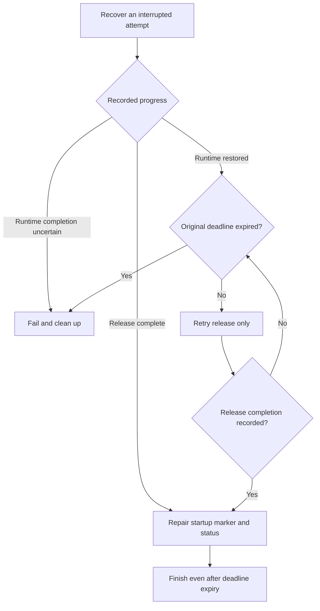
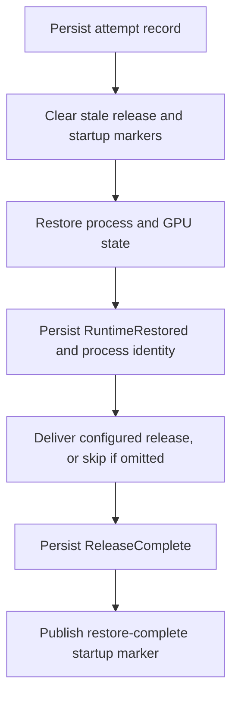

<!--
SPDX-FileCopyrightText: Copyright (c) 2026 NVIDIA CORPORATION & AFFILIATES. All rights reserved.
SPDX-License-Identifier: Apache-2.0
-->

# SNEP-411: Application profiles for checkpoint and restore

Tracking issue: [#411](https://github.com/ai-dynamo/snapshot/issues/411)

<!-- toc -->
- [Summary](#summary)
- [Motivation](#motivation)
  - [Goals](#goals)
  - [Non-Goals](#non-goals)
- [Proposal](#proposal)
  - [Defaults and user probes](#defaults-and-user-probes)
  - [Limitations, Risks, and Mitigations](#limitations-risks-and-mitigations)
    - [Backward compatibility and migration](#backward-compatibility-and-migration)
- [Design Details](#design-details)
  - [API](#api)
    - [Application contract](#application-contract)
    - [SnapshotJob](#snapshotjob)
    - [ApplicationProfile](#applicationprofile)
    - [Checkpoint metadata](#checkpoint-metadata)
  - [Capture and restore execution](#capture-and-restore-execution)
    - [Recovery guarantees](#recovery-guarantees)
  - [Security](#security)
  - [Monitoring](#monitoring)
  - [Test Plan](#test-plan)
  - [Graduation Criteria](#graduation-criteria)
- [Appendix](#appendix)
  - [Agent recovery](#agent-recovery)
  - [Diagnostic fields](#diagnostic-fields)
  - [Detailed test coverage](#detailed-test-coverage)
  - [References](#references)
<!-- /toc -->

## Summary

Application profiles define how Snapshot checks capture readiness and notifies
an application after restore. Administrators install profiles; users select them
in PodSnapshot or SnapshotJob.

## Motivation

Snapshot and the application need to communicate in both directions. Before
capture, the application tells Snapshot that it is safe to checkpoint. After
restore, Snapshot tells the application that process and GPU restoration is
complete and it may begin recovery. A restored process is not necessarily ready
to serve: the application may need to rebuild connections or other resources
before accepting requests.

Today, this communication uses files on a shared control volume. This proposal
adds HTTP and Unix-signal options while keeping application preparation and
recovery logic in the application. Reusable profiles let users select an engine
integration without repeating its endpoints, signals, and timing settings.

### Goals

- Configure both PodSnapshot and SnapshotJob through the same profile API.
- Record per-container profile names for resolution at capture and restore.
- Keep the legacy file integration available without requiring a profile.

### Non-Goals

- Requesting application preparation, draining, or quiescence.
- Continuing the source application after capture.
- Defining application serving-readiness checks or engine recovery steps.
- Running arbitrary commands or general-purpose hook sequences.

## Proposal

Administrators install an `ApplicationProfile` with optional `quiesceProbe` and
`restoreRelease` actions. Users select a profile by name for each captured
container. Snapshot checks readiness before capture and sends any configured
release notification after restoring process and GPU state.

The application is responsible for capture safety, recovery, and serving
readiness. Integration documentation lists supported engine versions and
required application configuration.

### Defaults and user probes

An empty profile is valid. Defaults depend on whether a profile is selected:

- **No profile:** capture waits for the source Pod's `Ready` condition; restore
  publishes the legacy `restore-complete` file notification. SnapshotJob injects
  file readiness only when the target has no user-defined readiness probe.
- **Selected profile:** an omitted `quiesceProbe` uses Pod readiness; an omitted
  `restoreRelease` sends no application notification.
- **All cases:** preserve every user-defined readiness, startup, and liveness
  probe on source and destination containers. When restore startup gating is
  enabled, inject the `restore-complete` startup probe only if the destination
  container has no user-defined startup probe.

On restored containers, custom startup probes must prevent premature startup
success, liveness must tolerate recovery, and readiness must stay false until
serving is available. Snapshot tracks restoration independently of these probes.

### Limitations, Risks, and Mitigations

Capture remains limited to one container per PodSnapshot. Profiles configure
interfaces an application already implements; they cannot make a serving
endpoint usable while the application is waiting for release. An HTTP control
endpoint must work after runtime restore, before release, including at a new
Pod IP. Only unencrypted HTTP is supported; HTTPS is out of scope.

Integration tests must validate capture and restore with the deployment's
probes and networking. Snapshot trusts the application's capture signal.

| Risk | Effect | Mitigation or owner responsibility |
| --- | --- | --- |
| Premature capture signal | The checkpoint contains unsafe application state. | The application maintains capture safety; integration tests verify recovery and inference. |
| Recreated profile name | New restores use a potentially incompatible definition. | Administrators validate compatibility or publish a new name. |
| Lost release response | Delivery repeats; deadline expiry may terminate an already released application. | Applications handle duplicates; Snapshot enforces the retry deadline. |
| Custom probes during recovery | Kubernetes restarts a recovering container. | Workload owners configure probes to tolerate recovery. |
| Shared HTTP endpoint | Requests for different destinations are indistinguishable. | The application coordinates releases, including destinations restored at different times. |
| Unprotected HTTP listener | An unintended caller releases the application. | The deployment restricts endpoint access. |

#### Backward compatibility and migration

Existing target-container lists and checkpoint artifacts remain valid. Users do
not need a profile for the legacy file integration, and artifacts without
profile metadata retain the legacy release notification. Two behaviors change:

- User-defined probes are preserved instead of replaced or removed. Workloads
  that relied on those overrides must adjust their probes for capture and restore.
- Without an explicit quiesce probe, capture waits for the whole Pod's `Ready`
  condition. Unready sidecars or readiness gates can delay captures previously
  allowed by the selected container's readiness alone.

Upgrade all participating node agents before enabling profile selection in the
operator or creating profiled work orders. Older agents ignore the new fields;
mixed-version execution of profiled work is unsupported. Validate application
profiles and probe configuration before migrating workloads. Before downgrading,
remove profiled captures and restores from the affected agents' execution scope;
existing profiled artifacts must remain assigned to compatible agents.

## Design Details

### API

All resources use `nvidia.com/v1alpha1`. The following Go definitions describe
the proposed JSON structure; CRD validation and defaulting enforce the rules
below.

#### Application contract

PodSnapshot selects profiles through `spec.applicationContract`, keyed by source
container name:

```go
type PodSnapshotSpec struct {
	Source              PodSnapshotSource    `json:"source"`
	ApplicationContract *ApplicationContract `json:"applicationContract,omitempty"`
}

type ApplicationContract struct {
	Containers map[string]ContainerApplicationContract `json:"containers"`
}

type ContainerApplicationContract struct {
	ProfileRef ApplicationProfileReference `json:"profileRef"`
}

type ApplicationProfileReference struct {
	Name string `json:"name"`
}
```

Each `containers` key must name a container selected by
`spec.source.podRef.containers`. Each binding requires a nonempty
`profileRef.name` that is a valid Kubernetes resource name for a cluster-scoped
profile. A selected container without a binding uses the default behavior
described in [Defaults and user probes](#defaults-and-user-probes); a missing
explicitly named profile never falls back to it.

Profile bindings are immutable with the PodSnapshot or SnapshotJob spec.
The existing target-container lists remain unchanged.

```yaml
apiVersion: nvidia.com/v1alpha1
kind: PodSnapshot
metadata:
  name: model-snapshot
spec:
  source:
    podRef:
      name: model-source
      containers: [main]
  applicationContract:
    containers:
      main:
        profileRef:
          name: cooperative-http-v1
```

#### SnapshotJob

`SnapshotJob.spec.podSnapshotTemplate.applicationContract` supplies the bindings
for the generated PodSnapshot. The updated structures are:

```go
type SnapshotJobSpec struct {
	PodTemplate           corev1.PodTemplateSpec `json:"podTemplate"`
	ActiveDeadlineSeconds *int64                 `json:"activeDeadlineSeconds,omitempty"`
	PodSnapshotTemplate   PodSnapshotTemplate    `json:"podSnapshotTemplate"`
}

type PodSnapshotTemplate struct {
	Metadata            *PodSnapshotTemplateMetadata `json:"metadata,omitempty"`
	TargetContainers    []string                     `json:"targetContainers,omitempty"`
	ApplicationContract *ApplicationContract         `json:"applicationContract,omitempty"`
}
```

`applicationContract` is the new optional field; the other fields retain their
existing semantics. Its container keys must belong to `targetContainers`.

For example, add this fragment alongside the existing `spec.podTemplate`:

```yaml
spec:
  podSnapshotTemplate:
    targetContainers: [main]
    applicationContract:
      containers:
        main:
          profileRef:
            name: cooperative-http-v1
```

The controller copies these bindings into `PodSnapshot.spec.applicationContract`.

#### ApplicationProfile

ApplicationProfile is cluster-scoped and its spec is immutable. Administrators
can publish a new name or delete and recreate an existing one. References use
only the name, not the profile UID.

```go
type ApplicationProfile struct {
	metav1.TypeMeta   `json:",inline"`
	metav1.ObjectMeta `json:"metadata,omitempty"`
	Spec              ApplicationProfileSpec `json:"spec"`
}

type ApplicationProfileSpec struct {
	QuiesceProbe   *QuiesceProbe   `json:"quiesceProbe,omitempty"`
	RestoreRelease *RestoreRelease `json:"restoreRelease,omitempty"`
}

type QuiesceProbe struct {
	File    *ControlFileAction   `json:"file,omitempty"`
	HTTPGet *LifecycleHTTPAction `json:"httpGet,omitempty"`

	InitialDelaySeconds *int32 `json:"initialDelaySeconds,omitempty"`
	PeriodSeconds       *int32 `json:"periodSeconds,omitempty"`
	TimeoutSeconds      *int32 `json:"timeoutSeconds,omitempty"`
	SuccessThreshold    *int32 `json:"successThreshold,omitempty"`
}

type RestoreRelease struct {
	File     *ControlFileAction   `json:"file,omitempty"`
	HTTPPost *LifecycleHTTPAction `json:"httpPost,omitempty"`
	Signal   *SignalAction        `json:"signal,omitempty"`

	PeriodSeconds  *int32 `json:"periodSeconds,omitempty"`
	TimeoutSeconds *int32 `json:"timeoutSeconds,omitempty"`
}

type ControlFileAction struct {
	Name string `json:"name"`
}

type LifecycleHTTPAction struct {
	Path string `json:"path"`
	Port int32  `json:"port"`
}

type SignalAction struct {
	Name string `json:"name"`
}
```

When present, `quiesceProbe` requires exactly one of `file` or `httpGet`, and
`restoreRelease` requires exactly one of `file`, `httpPost`, or `signal`.
Omitted actions follow the [proposal defaults](#defaults-and-user-probes).

Probe handlers and timing fields follow the structure of
[Kubernetes probes](https://kubernetes.io/docs/concepts/workloads/pods/probes/).
Defaults are `initialDelaySeconds: 0`, `periodSeconds: 1`,
`timeoutSeconds: 1`, and `successThreshold: 1`. The initial delay is nonnegative;
other timing values and the success threshold must be positive. A release
defaults to a one-second period and one-second timeout. The timeout bounds one
attempt; it is not the total operation deadline.

There is no `failureThreshold`. An unsuccessful observation resets the success
count and keeps capture waiting without restarting the container. Restarting or
replacing the source container invalidates accumulated successes. The initial
delay starts from that container incarnation's start time.

File names must be single path components within the container's
`SNAPSHOT_CONTROL_DIR`. Absolute paths, separators, `.` and `..` are invalid.
The probe and release cannot use the same name. Internal names such as
`cuda-checkpoint-job` are reserved; `ready-for-snapshot` and `restore-complete`
remain valid for their respective actions.

HTTP paths must begin with `/` and contain no authority, query, or fragment.
Ports range from 1 through 65535. Only HTTP is supported, and the agent derives
the host from the target Pod IP. Host overrides, custom headers, and request
bodies are not part of this API.
Signal names are restricted to `SIGUSR1` and `SIGUSR2`.

For example, a cooperative application's profile can declare:

```yaml
apiVersion: nvidia.com/v1alpha1
kind: ApplicationProfile
metadata:
  name: cooperative-http-v1
spec:
  quiesceProbe:
    httpGet:
      path: /snapshot/quiesced
      port: 9001
    periodSeconds: 1
    timeoutSeconds: 2
    successThreshold: 1
  restoreRelease:
    httpPost:
      path: /snapshot/restored
      port: 9001
    periodSeconds: 1
    timeoutSeconds: 2
```

These paths illustrate the proposed application contract; they are not existing
engine endpoints. A file profile instead uses `quiesceProbe.file.name:
ready-for-snapshot` and `restoreRelease.file.name: restore-complete`.

#### Checkpoint metadata

Add the same optional `applicationContract` field to `PodSnapshotContentSpec`
and checkpoint metadata:

```go
// Added to PodSnapshotContentSpec and checkpoint metadata:
// ApplicationContract *ApplicationContract `json:"applicationContract,omitempty"`
```

The operator copies the requested bindings into the immutable content spec;
the agent records them with the checkpoint. Metadata retains profile names,
not definitions or profile UIDs. Restore maps each captured source container's
binding to its destination containers. Destination Pods do not select profiles.

### Capture and restore execution

**Capture.** The agent resolves a selected profile at the start of an attempt
and retains its definition across retries and agent restarts. An explicit
`quiesceProbe` is the sole application capture gate: a regular file marker or
HTTP GET status `200` indicates success. The application must clear stale file
markers before initialization. Once the success threshold is reached, the agent
revalidates source identity before capture.

The Pod readiness fallback includes other containers and readiness gates.
Whichever signal is used, it must indicate that the application is safe to
capture and will remain so until capture.

**Restore and release.** Recover existing attempts from their saved definitions
before looking up profiles. Profile deletion or recreation does not change an
active attempt, including after an agent restart.

Before a new attempt, resolve the checkpoint's profile names to their current
definitions and validate destination mappings. A missing named profile blocks
restore before CRIU runs; reconciliation retries the lookup. Never fall back
to the default behavior or a capture-time definition.

After successful CRIU and CUDA restore, perform the configured
action for each destination:

- **File:** atomically publish the marker in the destination's control directory.
- **HTTP:** POST an empty body. Status `200` or `204` acknowledges acceptance
  into the application's recovery logic; recovery may continue asynchronously.
  All other statuses and connection failures are retried until the restore
  deadline. GET and POST response bodies are ignored; no attempt ID is sent.
- **Signal:** send `SIGUSR1` or `SIGUSR2` to the verified restored process-tree
  root, not the placeholder process. The handler must be installed before
  capture. Successful delivery does not acknowledge handler completion.
- **Omitted:** proceed without an application notification.

The application must make release idempotent. Snapshot may repeat it after a
lost response or agent restart. Snapshot records completion only after the
configured action succeeds or is omitted.

HTTP requests address a Pod IP, port, and path without a container identifier.
A shared endpoint must make each acknowledgment cover the required release.

**Deadlines.** SnapshotJob's `activeDeadlineSeconds` bounds its source lifecycle,
including capture readiness. A direct PodSnapshot waits until its capture gate
succeeds, the request is deleted, or the source becomes terminal. Probe timeouts
bound individual observations, not the total wait.

The agent restore timeout covers runtime restoration and release. Persist its
absolute deadline so retries and restarts cannot extend it. If the release step
has not been recorded complete at that deadline, fail and clean up the
destination; the application may have received a notification whose response
was lost.

#### Recovery guarantees

Attempt progress survives agent restarts. Only one agent may execute or recover
a destination attempt, and recovery must verify the destination's identity.
Stale release markers must not release a restored process early.



Recovery never repeats CRIU restore in the same container. Once release
completion is recorded, marker or status failures require repair, not cleanup.

Profile-based restores use agent-owned recovery records, not workload-written
markers. Unprofiled restores without a record keep the legacy marker recovery
path. The [agent recovery sequence](#agent-recovery) specifies persistence and
startup-marker ordering.

### Security

Only administrators can create, update, or delete profiles. Installed profiles
are available to users already authorized to request snapshots in their
namespace. Selecting a profile grants no additional authority over a target Pod;
source identity checks and namespace boundaries remain mandatory. Content work
orders carry validated profile references, not user-supplied action definitions.

HTTP requests go directly to the selected Pod IP, without redirects or
environment-configured proxies. Host-network Pods are rejected for HTTP
interactions. Pod networking does not isolate containers, so administrators must
review profiles for the whole Pod trust boundary. The deployment must restrict
the unencrypted control listener to intended callers.

File access is confined to the selected container's control directory using
operations that reject symlinks and traversal. Signal recipients are resolved
from the restored process identity; users cannot supply a host PID. Profile
bindings and attempt records must retain the integrity protections of other
agent-owned metadata.

Logs and Events record action type and outcome, not HTTP response bodies or
application memory.

**Open question:** should HTTP actions support authentication initially, and how
should credentials be configured for capture and restore? The proposed API has
no credential fields; initial support remains undecided.

### Monitoring

Expose waiting for quiescence and release failures through existing snapshot
and restore status reporting. Add Events for profile resolution failure,
invalid lifecycle configuration, and release failure. SnapshotJob deadline
failures retain their existing reporting.
Routine unsuccessful probe polls remain debug logs rather than Events.
[Diagnostic fields](#diagnostic-fields) are listed in the appendix.

### Test Plan

Validation must establish that:

- API defaults, bindings, and probe preservation match the contract.
- Profile replacement affects new attempts without changing active ones.
- Crashes and retries preserve deadlines and never repeat runtime restoration.
- Transport isolation and legacy compatibility hold.
- Real application integrations complete capture, restore, and inference.

The [detailed test coverage](#detailed-test-coverage) lists failure cases and
transport-specific checks. A transport combination is advertised only after a
real application integration validates it.

### Graduation Criteria

Alpha requires the API validation, legacy compatibility, and transport/recovery
tests, with documented supported application versions and topologies.
Beta requires operational evidence under repeated agent restarts and a security
review of the privileged execution paths. GA requires a stable application
contract, compatibility coverage for previously produced artifacts, and
documented failure and recovery procedures.

## Appendix

The implementation sequence and test cases below support the contract above.

### Agent recovery

The control volume remains required for runtime coordination. A new attempt
follows this sequence; recovery resumes from recorded progress.



The attempt record contains the artifact identity, Pod UID, container
incarnation, attempt ID, absolute deadline, and resolved profile definition.
Failure to persist `RuntimeRestored` prevents release. Failure to persist
`ReleaseComplete` leaves the release step retriable; it does not itself justify
cleanup. If the release action writes `restore-complete`, that write also
publishes the startup marker.

Recovery from `RuntimeRestored` retries only the release step, within the original
deadline. Once `ReleaseComplete` is recorded, marker or status write failures
require repair, not destructive cleanup, even after the deadline expires.
If runtime completion cannot be established, fail and clean up the attempt
without replaying restore in the same container.

Persist records atomically in an agent-only, root-owned hostPath directory,
keyed by Pod UID and container incarnation. One owner must hold exclusive access
through execution, recovery, and cleanup across agent instances. Revalidate
container membership, node boot identity, PID, and process start time before
recovery; use a process handle for signaling to avoid PID reuse. Remove records
after the destination is gone.

Legacy restores with neither a profile binding nor an attempt record retain
the existing completion-marker recovery path. Profile-based restores require
the agent-owned record; workload-written markers are not completion evidence.

### Diagnostic fields

Log profile name, source and destination container, attempt ID, transport, attempt
count, elapsed time, and the last HTTP failure status when applicable.

### Detailed test coverage

- **API and propagation:** optional actions and empty profiles, handler
  exclusivity, defaults, immutable specs, target-container validation, and
  bindings copied from SnapshotJob through content and checkpoint metadata.
  Preserve the existing target-name lists and single-container capture limit.
- **Capture and probes:** explicit quiesce probes versus Pod readiness fallback,
  success thresholds, source incarnation changes, cancellation, and deadlines.
  Preserve every user-defined probe on source and destination containers;
  inject SnapshotJob file readiness only when no profile and no user readiness
  probe are present. Inject restore startup gating only when enabled and no user
  startup probe exists.
- **Profile resolution:** missing names block new attempts and become usable
  after recreation. New attempts use replacement definitions; existing attempts
  retain saved definitions across profile deletion and agent restart.
- **Restore recovery:** inject failures around runtime completion, release,
  record persistence, and startup-marker publication. Never replay an uncertain
  or completed runtime restore. Retry release idempotently within the original
  deadline; repair recorded completion without destructive cleanup. Cover
  overlapping agents, omitted release, and legacy marker recovery.
- **Transports:** HTTP success codes, ignored response bodies, retries, redirects,
  proxies, host-network rejection, file confinement, stale markers, and signal
  delivery to the restored root. Verify destination isolation for file/signal
  and application-owned coordination for shared HTTP endpoints.
- **Application integrations:** retain existing file integrations and validate
  HTTP and file-readiness/signal-release with actual inference after restore.
  Cover a changed Pod IP, release before serving starts, asynchronous recovery,
  and compatible custom probes. Advertise a transport combination only after a
  real application integration validates it.

### References

- [Workload contract](../../reference/workload-contract.md)
- [Restore Pod contract](../../reference/restore-pod-contract.md)
- [Kubernetes probes](https://kubernetes.io/docs/concepts/workloads/pods/probes/)
- [Kubernetes lifecycle hooks](https://kubernetes.io/docs/concepts/containers/container-lifecycle-hooks/)
- [gVisor application-driven checkpoint/restore](https://gvisor.dev/docs/user_guide/checkpoint_restore/#application-driven-checkpointrestore)
